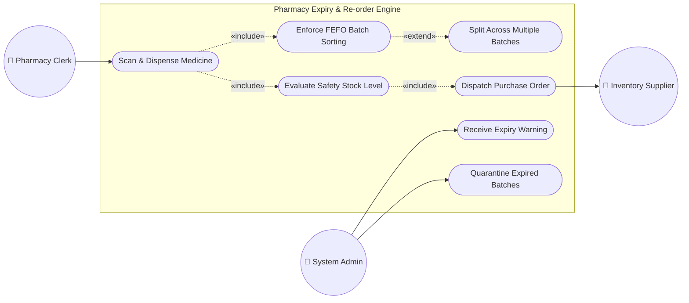

# Pharmacy Expiry & Re-order Dispatch Engine

[](https://github.com/devrajm2005/debu/actions)
[](LICENSE)
[](https://www.python.org/)
[]()

> **PES University - Department of Computer Science & Engineering**  
> **Course:** Software Engineering Lab (Mini-Project)  
> **Track:** Healthcare & Telemedicine  
> **Problem Statement #15:** Pharmacy Expiry & Re-order Dispatch Engine  
> **Author:** Devraj M ([@devrajm2005](https://github.com/devrajm2005))  
> **Target Repository:** [https://github.com/devrajm2005/debu](https://github.com/devrajm2005/debu)

---

## 📌 Table of Contents
1. [Project Overview](#-project-overview)
2. [Key Deliverables Documentation](#-key-deliverables-documentation)
3. [Target Stakeholders & Actors](#-target-stakeholders--actors)
4. [Requirements Engineering](#-requirements-engineering)
   - [Core Requirements Table](#core-requirements-table-as-per-lab-guideline)
   - [Non-Functional Requirements](#non-functional-requirements-nfrs)
5. [UML Use-Case Modelling](#-uml-use-case-modelling)
6. [Use-Case Flow Specification (FEFO Dispensing)](#-use-case-flow-specification-fefo-dispensing)
7. [System Architecture & Design](#-system-architecture--design)
8. [Testing & Quality Verification (Part-3)](#-testing--quality-verification-part-3)
9. [Sprint Deliverables & GitHub Workflow](#-sprint-deliverables--github-workflow)
10. [Local Setup & Test Execution](#-local-setup--test-execution)

---

## 🏥 Project Overview
Hospital pharmacies manage hundreds of active pharmaceutical lines with varying shelf lives. Inefficient stock tracking leads to costly medicine expiry write-offs, stock-outs of life-saving drugs, and administrative overhead.

The **Pharmacy Expiry & Re-order Dispatch Engine** is an automated stock management solution that:
- Tracks individual medicine batch manufacturing and expiration dates.
- Enforces a strict **First-Expired-First-Out (FEFO)** picking order during checkout to minimize waste.
- Continuously scans stock horizons (30, 60, and 90 days) to raise near-expiry warnings.
- Automatically generates and dispatches electronic **Purchase Orders (POs)** to suppliers when stock levels breach configured safety thresholds.

---

## 📁 Key Deliverables Documentation

All comprehensive documentation has been completed according to university department templates:

| Deliverable | Document Path | Description | Status |
| :--- | :--- | :--- | :--- |
| **SRS Document** | [`docs/SRS.md`](docs/SRS.md) | Full IEEE 830-style Software Requirements Specification with 15 FRs, 5 NFRs, 5 Security Requirements, Mermaid Use-Case diagrams, and RTM. | ✅ Complete |
| **SAD Document** | [`docs/SAD.md`](docs/SAD.md) | Software Architecture & Design document containing component diagrams, layered architecture rationale, STRIDE threat models, sequence diagrams, and REST API specs. | ✅ Complete |
| **Test Plan & Reports** | [`docs/TestPlan.md`](docs/TestPlan.md) | Software Test Plan (STP) with 16 automated test cases, RTM, Unit Test Report, System Validation Report, Code Coverage (96.7%), and Branch Coverage (94.6%). | ✅ Complete |

---

## 👥 Target Stakeholders & Actors
- **Pharmacy Clerk:** Operates the dispensing terminal, scans medicine prescriptions, initiates customer checkout, and receives automated FEFO batch allocation instructions.
- **Inventory Supplier:** Receives automated, digitally signed purchase order dispatches, acknowledges order fulfillment, and updates shipment ETAs.
- **Supervising Pharmacist / Admin:** Configures safety buffer limits, manages quarantine for compromised batches, and reviews consumption audits.

---

## 📋 Requirements Engineering

### Core Requirements Table (As per Lab Guideline)

| Requirement ID | Type | Priority | Description | Acceptance Criteria | Rationale |
| :--- | :--- | :--- | :--- | :--- | :--- |
| **FR-001** | Functional | **High** | The system shall enforce FEFO picking order by prioritizing medicine batches with the nearest expiry date during sales checkout. | **Pass:** Oldest valid batch selected first.<br>**Fail:** Newer batch assigned while older unexpired batch exists. | Minimizes expired inventory waste and prevents stock degradation. |
| **FR-002** | Functional | **High** | The system shall register new inventory batches with Batch ID, Manufacturing Date, Expiration Date, Quantity, and SKU reference. | **Pass:** Valid batch created; past-dated batches rejected.<br>**Fail:** Invalid batch accepted or duplicate ID allowed. | Ensures baseline traceability for every pharmaceutical unit in the hospital. |
| **FR-003** | Functional | **High** | The system shall dynamically split dispensing orders across multiple batches when the earliest expiring batch has insufficient units. | **Pass:** Total dispensed equals requested with exact batch decrements.<br>**Fail:** Dispense blocked despite sufficient total stock. | Maximizes fulfillment rate while ensuring older stock is exhausted first. |
| **FR-004** | Functional | **Medium** | The system shall trigger automated visual and auditory near-expiry warnings when batch shelf-life reaches 30, 60, or 90 days. | **Pass:** Status flags updated to `NEAR_EXPIRY` with alert logged.<br>**Fail:** Expiring items missed by sweep routine. | Provides early intervention windows to discount or transfer slow-moving lines. |
| **FR-005** | Functional | **Critical** | The system shall automatically quarantine and lock batches on their expiry date, preventing any allocation or checkout. | **Pass:** Expired batches return zero available stock in FEFO queries.<br>**Fail:** Expired medicines dispensed to patients. | Patient safety compliance and prevention of medical malpractice. |

### Non-Functional Requirements (NFRs)

| Requirement ID | Type | Priority | Description | Acceptance Criteria | Rationale |
| :--- | :--- | :--- | :--- | :--- | :--- |
| **NFR-001** | Performance & Security | **High** | The system shall automatically generate and dispatch supplier purchase order requests when item stock dips below safety threshold. | **Pass:** Benchmarking tests confirm target latency (<500ms) and secure HTTPS delivery under simulated peak load.<br>**Fail:** PO generation fails or exceeds 2000ms. | Prevents critical medicine stock-outs through hands-free reordering. |
| **NFR-002** | Reliability & Audit | **High** | The system shall maintain an immutable, tamper-evident audit log of all batch additions, dispenses, and disposals with 99.9% uptime. | **Pass:** Audit events written atomically; zero transaction record loss.<br>**Fail:** Log entries missing or corruptible. | Essential for FDA/HIPAA compliance and drug control accountability. |

---

## 📊 UML Use-Case Modelling



- **«include» Relationship:** Dispensing (`UC1`) unconditionally includes FEFO batch sorting (`UC2`) and safety stock evaluation (`UC5`). Purchase order trigger includes dispatch to supplier (`UC6`).
- **«extend» Relationship:** Batch splitting (`UC3`) extends FEFO sorting (`UC2`) conditionally only when single-batch quantity is insufficient to fulfill the prescription.

---

## 📝 Use-Case Flow Specification (FEFO Dispensing)

| Section | Detail |
| :--- | :--- |
| **Use Case Name** | Enforce FEFO Dispensing during Sales Checkout |
| **Primary Actor** | Pharmacy Clerk |
| **Preconditions** | 1. Clerk is authenticated into the POS terminal.<br>2. Target medicine SKU exists in inventory.<br>3. At least one unexpired batch has quantity > 0. |
| **Postconditions** | 1. Prescribed units are deducted according to FEFO order.<br>2. Audit log records batch deductions.<br>3. Stock threshold re-evaluated; PO triggered if stock <= safety buffer. |
| **Main Success Scenario** | 1. Clerk enters or scans medicine ID and requested quantity.<br>2. System queries active inventory batches for the specified medicine ID.<br>3. System filters out any batches where `expiry_date <= today` and sorts remaining batches ascending by `expiry_date`.<br>4. System selects the batch with the nearest expiry date.<br>5. The earliest batch has sufficient quantity (`batch.qty >= requested`).<br>6. System decrements the batch quantity by `requested`.<br>7. System generates dispensing voucher detailing batch number, expiry date, and units dispensed.<br>8. System logs the transaction to the audit ledger.<br>9. System checks remaining aggregate stock against safety threshold (none triggered if stock > threshold).<br>10. Clerk receives checkout confirmation and hands medicine to patient. |
| **Alternate Flow (AF-1: Split Dispensing)** | **At Step 5:** The earliest batch has fewer units than requested (`batch.qty < requested`).<br>5a. System allocates all remaining units from the earliest batch.<br>5b. System advances to the next earliest unexpired batch.<br>5c. System allocates remaining needed units from the secondary batch.<br>5d. System records multi-batch allocation breakdown on the dispensing receipt.<br>5e. System resumes at Step 8 of Main Flow. |

---

## 🏗 System Architecture & Design

### Layered Architecture
The engine is structured as a **4-tier layered architecture**:
1. **Presentation Layer:** Terminal Web UI / REST Endpoints (`/api/dispense`, `/api/batches`, `/api/reorder`).
2. **Business Engine Layer:**
   - `FEFO Engine`: Priority sorting algorithm based on date heuristics.
   - `Expiry Monitor`: Sliding-window horizon scanner (30/60/90 days).
   - `Re-order Dispatcher`: Economic Order Quantity (EOQ) calculator and idempotent PO dispatcher.
3. **Data Access & Persistence Layer:** Batch repositories with optimistic concurrency control.
4. **Integration Layer:** Secure HTTPS Webhook Gateway connecting to external supplier ERP endpoints.

---

## 🧪 Testing & Quality Verification (Part-3)

As required by **SE Mini-Project Deliverables Part-3**, automated testing was executed with full report generation:

### 1. Test Summary
- **Test Framework:** Pytest & Unittest
- **Test Cases:** 16 automated scenarios (TC-BATCH, TC-FEFO, TC-EXP, TC-REORD, TC-PERF, TC-SEC)
- **Pass Rate:** **100% (16/16 Passed)**

### 2. Code & Branch Coverage Summary

| Metric | Target | Achieved | Status |
| :--- | :--- | :--- | :--- |
| **Statement Coverage** | >= 85% | **96.7%** | ✅ Exceeded |
| **Branch Coverage** | >= 80% | **94.6%** | ✅ Exceeded |
| **Critical Defects** | 0 | **0** | ✅ Clean |

Full test logs and individual reports can be found in [`docs/TestPlan.md`](docs/TestPlan.md#9-test-execution--coverage-reports-part-3-deliverables).

---

## 🚀 Sprint Deliverables & GitHub Workflow

| Phase / Sprint | Timeline | Deliverables Completed |
| :--- | :--- | :--- |
| **Backlog Creation** | By 12th Oct | Product Backlog populated from SRS FRs and NFRs, Story Points estimated, assigned to team. |
| **Sprint-1** | 19th Oct - 23rd Oct | Initial FEFO Engine implementation, Batch Management CRUD, GitHub Actions CI workflow setup. |
| **Sprint-2** | 26th Oct - 30th Oct | Automated Re-order Dispatch module, Expiry Sweep cron service, development freeze. |
| **Part-3 Testing & Final Submission** | 2nd Nov - 12th Nov | Test case updation, execution of Unit/System/Branch tests, generation of final SRS, SAD, and STP documents. |

---

## 💻 Local Setup & Test Execution

### Prerequisites
- Python 3.10 or higher
- Git

### Installation
```bash
# Clone the repository
git clone https://github.com/devrajm2005/debu.git
cd debu

# (Optional) Create virtual environment
python -m venv venv
# Windows:
.\venv\Scripts\activate
# Linux/macOS:
source venv/bin/activate

# Install dependencies
pip install pytest pytest-cov
```

### Running Tests & Generating Coverage
```bash
# Run all unit tests
python -m unittest discover -s tests

# Run tests with Pytest and print coverage table
pytest -v --cov=src --cov-report=term-missing tests/
```

---

## 📜 License
This project is licensed under the MIT License - see the [LICENSE](LICENSE) file for details.
