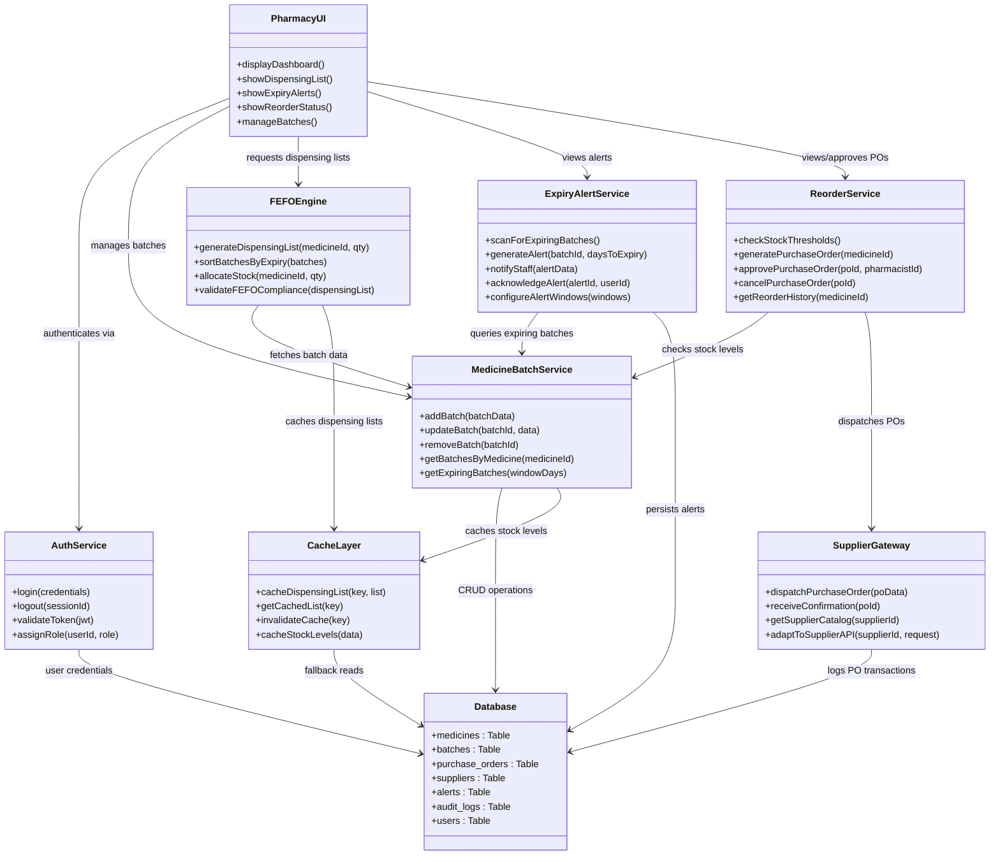
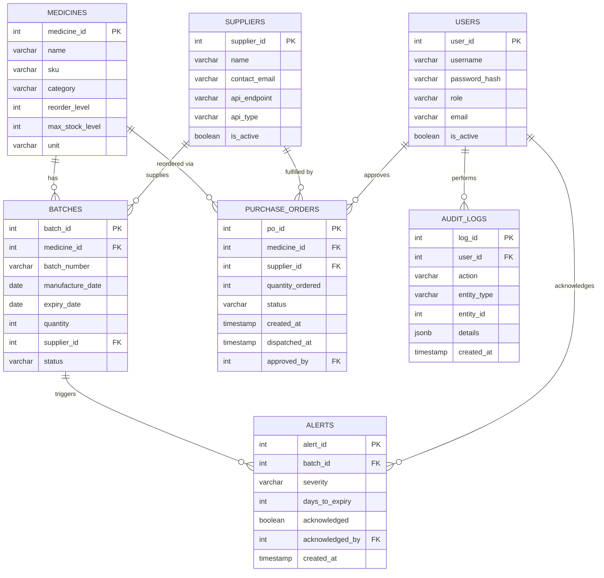
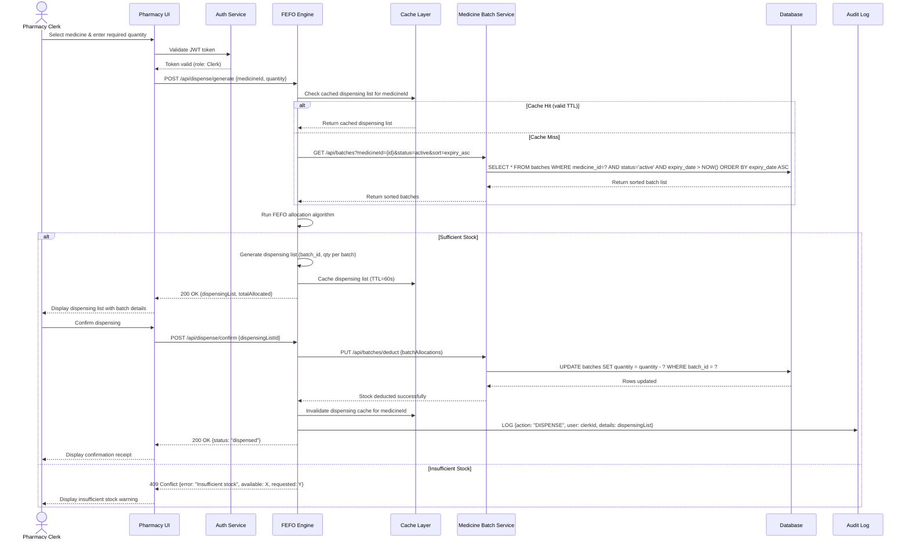
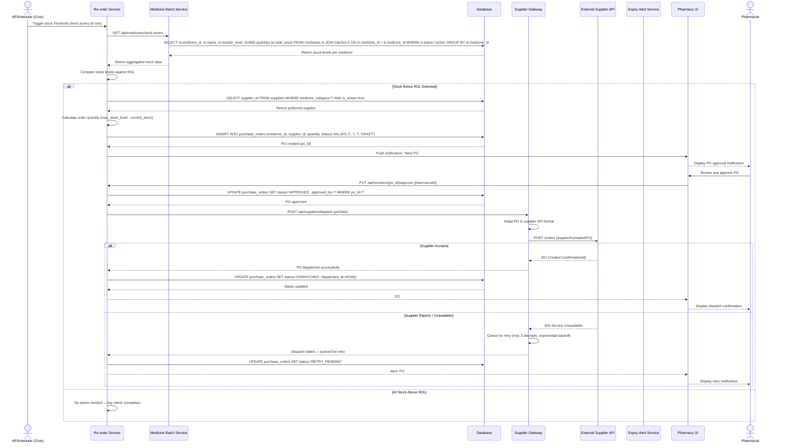
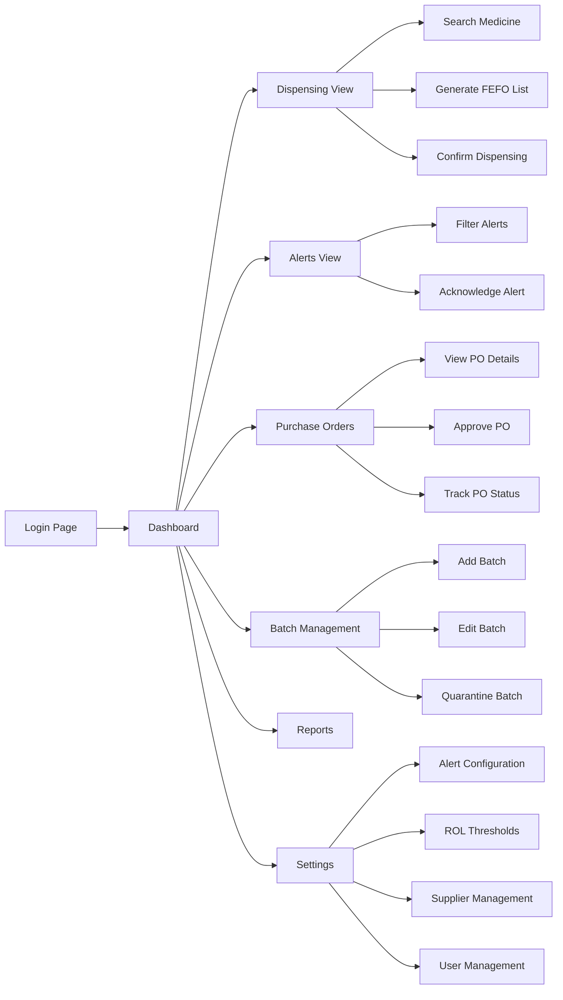

# Software Architecture and Design Document

## Pharmacy Expiry & Re-order Dispatch Engine

---

|                  |                                                        |
| ---------------- | ------------------------------------------------------ |
| **Project**      | Pharmacy Expiry & Re-order Dispatch Engine              |
| **Domain**       | Healthcare & Telemedicine                               |
| **Problem Statement** | #15                                                |
| **University**   | PES University — Department of Computer Science & Engineering |
| **Author(s)**    | Devraj M (devrajm2005)                                  |
| **Version**      | 1.0                                                     |
| **Date**         | November 2026                                           |
| **Status**       | Submission-Ready                                        |

---

## Revision History

| Version | Date             | Author              | Description               |
| ------- | ---------------- | -------------------- | ------------------------- |
| 1.0     | November 2026    | Devraj M (devrajm2005) | Initial release of SAD document |

---

## Table of Contents

1. [Introduction](#1-introduction)
   - 1.1 [Purpose](#11-purpose)
   - 1.2 [Scope](#12-scope)
   - 1.3 [Intended Audience](#13-intended-audience)
   - 1.4 [Definitions, Acronyms, and Abbreviations](#14-definitions-acronyms-and-abbreviations)
2. [Document Overview](#2-document-overview)
   - 2.1 [How to Use This Document](#21-how-to-use-this-document)
   - 2.2 [Related Documents](#22-related-documents)
3. [Architecture](#3-architecture)
   - 3.1 [Goals and Constraints](#31-goals-and-constraints)
   - 3.2 [Stakeholders and Concerns](#32-stakeholders-and-concerns)
   - 3.3 [Component (UML) Diagram](#33-component-uml-diagram)
   - 3.4 [Component Descriptions](#34-component-descriptions)
   - 3.5 [Chosen Architecture Pattern and Rationale](#35-chosen-architecture-pattern-and-rationale)
   - 3.6 [Technology Stack and Data Stores](#36-technology-stack-and-data-stores)
   - 3.7 [Risks and Mitigations](#37-risks-and-mitigations)
   - 3.8 [Traceability to Requirements](#38-traceability-to-requirements)
   - 3.9 [Security Architecture — STRIDE Threat Modeling](#39-security-architecture--stride-threat-modeling)
4. [Design](#4-design)
   - 4.1 [Design Overview](#41-design-overview)
   - 4.2 [UML Sequence Diagrams](#42-uml-sequence-diagrams)
   - 4.3 [API Design](#43-api-design)
   - 4.4 [Error Handling, Logging and Monitoring](#44-error-handling-logging-and-monitoring)
   - 4.5 [UX Design](#45-ux-design)
   - 4.6 [Open Issues and Next Steps](#46-open-issues-and-next-steps)
5. [Appendices](#5-appendices)
   - 5.1 [Glossary](#51-glossary)
   - 5.2 [References](#52-references)
   - 5.3 [Tools](#53-tools)

---

## 1. Introduction

### 1.1 Purpose

The purpose of this Software Architecture and Design (SAD) document is to provide a comprehensive architectural blueprint and detailed design specification for the **Pharmacy Expiry & Re-order Dispatch Engine**. This system is designed to automate stock management in hospital pharmacies by tracking medicine batch expiry dates, generating First-Expired-First-Out (FEFO) dispensing lists, and triggering automated purchase orders when inventory levels fall below predefined thresholds.

This document translates the functional and non-functional requirements captured in the Software Requirements Specification (SRS) into a concrete, implementable architecture. It serves as the authoritative reference for developers, testers, and stakeholders throughout the development lifecycle.

### 1.2 Scope

The Pharmacy Expiry & Re-order Dispatch Engine encompasses the following capabilities:

- **Batch Tracking**: Recording and monitoring medicine batches with expiry dates, quantities, and supplier information.
- **FEFO Dispensing**: Automatically generating dispensing lists that prioritize medicines closest to their expiry date, ensuring minimal waste and regulatory compliance.
- **Expiry Alert System**: Proactively notifying pharmacy staff about medicines approaching expiry within configurable time windows (e.g., 30, 60, 90 days).
- **Automated Re-ordering**: Detecting when stock levels drop below configurable thresholds and generating purchase orders dispatched to registered suppliers.
- **Dashboard and Reporting**: Providing real-time visibility into inventory status, expiry risk, dispensing history, and re-order activity.
- **Supplier Integration**: Interfacing with supplier systems via a gateway to transmit purchase orders and receive order confirmations.

**Out of Scope**: Point-of-sale billing, clinical decision support, electronic health record (EHR) integration, and controlled substance scheduling are not addressed by this system.

### 1.3 Intended Audience

| Audience               | Use of This Document                                                         |
| ---------------------- | ---------------------------------------------------------------------------- |
| Developers             | Implementation guide for components, APIs, data models, and integration points |
| Testers / QA Engineers | Understanding system behavior for designing test cases aligned to architecture |
| Project Manager        | Tracking architectural decisions, risks, and traceability to requirements      |
| Hospital Admin         | Understanding system capabilities, security posture, and compliance aspects    |
| Faculty / Evaluators   | Assessing architectural rigor, completeness, and adherence to SE principles    |

### 1.4 Definitions, Acronyms, and Abbreviations

| Term / Acronym | Definition                                                                 |
| -------------- | -------------------------------------------------------------------------- |
| FEFO           | First-Expired-First-Out — dispensing strategy that prioritizes items closest to expiry |
| SAD            | Software Architecture and Design                                           |
| SRS            | Software Requirements Specification                                       |
| STP            | Software Test Plan                                                         |
| RTM            | Requirements Traceability Matrix                                           |
| API            | Application Programming Interface                                          |
| REST           | Representational State Transfer                                            |
| CRUD           | Create, Read, Update, Delete                                               |
| HIPAA          | Health Insurance Portability and Accountability Act                        |
| FDA            | Food and Drug Administration                                               |
| STRIDE         | Spoofing, Tampering, Repudiation, Information Disclosure, Denial of Service, Elevation of Privilege |
| PO             | Purchase Order                                                             |
| SKU            | Stock Keeping Unit                                                         |
| ROL            | Re-Order Level — the threshold quantity that triggers a purchase order      |
| UML            | Unified Modeling Language                                                  |
| RBAC           | Role-Based Access Control                                                  |
| TLS            | Transport Layer Security                                                   |
| JWT            | JSON Web Token                                                             |

---

## 2. Document Overview

### 2.1 How to Use This Document

This document is organized in a top-down fashion:

1. **Section 1 (Introduction)** establishes context, scope, and terminology.
2. **Section 2 (Document Overview)** describes how to navigate this document and its relationship to other project deliverables.
3. **Section 3 (Architecture)** presents the high-level architecture — goals, constraints, component decomposition, architecture pattern selection, technology stack, risk analysis, requirements traceability, and security modeling. Readers seeking a system-wide understanding should focus here.
4. **Section 4 (Design)** dives into detailed design — sequence diagrams illustrating key workflows, API contracts, error handling strategies, and UX design. Developers and testers should focus here for implementation and testing guidance.
5. **Section 5 (Appendices)** contains supplementary material including the glossary, references, and tools used.

### 2.2 Related Documents

| Document                              | Description                                                                 |
| ------------------------------------- | --------------------------------------------------------------------------- |
| Software Requirements Specification (SRS) | Defines all functional and non-functional requirements for the system       |
| Software Test Plan (STP)              | Describes the testing strategy, test cases, and acceptance criteria          |
| Requirements Traceability Matrix (RTM) | Maps requirements to design components, test cases, and deliverables        |

---

## 3. Architecture

### 3.1 Goals and Constraints

#### 3.1.1 Architectural Goals

| ID   | Goal                          | Description                                                                                         |
| ---- | ----------------------------- | --------------------------------------------------------------------------------------------------- |
| AG-1 | Accurate FEFO Dispensing      | The system must always generate dispensing lists that strictly follow FEFO ordering across all medicine batches, ensuring zero dispensing-order errors. |
| AG-2 | Real-Time Expiry Alerts       | Pharmacy staff must receive timely, actionable alerts for medicines approaching expiry, configurable at 30, 60, and 90-day windows, with delivery latency under 5 seconds. |
| AG-3 | Automated Re-ordering         | When stock for any medicine falls below its configured Re-Order Level (ROL), the system must automatically generate and dispatch a purchase order to the designated supplier without manual intervention. |
| AG-4 | High Availability             | The system must maintain 99.5% uptime during hospital operating hours (6 AM – 11 PM) to ensure uninterrupted pharmacy operations. |
| AG-5 | Auditability                  | Every dispensing action, stock modification, alert acknowledgment, and purchase order must be logged with timestamps and actor identity for regulatory audit trails. |
| AG-6 | Scalability                   | The architecture must support scaling from a single-hospital deployment to a multi-branch hospital network without fundamental redesign. |
| AG-7 | Usability                     | Pharmacy clerks and pharmacists must be able to complete core tasks (dispense, review alerts, approve POs) within 3 clicks from the dashboard. |

#### 3.1.2 Architectural Constraints

| ID   | Constraint                    | Description                                                                                         |
| ---- | ----------------------------- | --------------------------------------------------------------------------------------------------- |
| AC-1 | FDA Compliance                | All medicine tracking and dispensing logic must comply with FDA drug supply chain requirements, including batch-level traceability. |
| AC-2 | HIPAA Compliance              | Any patient-adjacent data (e.g., prescription-linked dispensing) must be handled in accordance with HIPAA privacy and security rules. |
| AC-3 | Hospital Network Restrictions | The system operates within the hospital's internal network; external supplier communication must pass through a secured gateway with allowlisted endpoints only. |
| AC-4 | Browser-Based UI              | The front-end must be accessible via modern web browsers (Chrome, Firefox, Edge) without requiring native application installation. |
| AC-5 | Budget Constraints            | The system must use open-source technologies to minimize licensing costs for the hospital. |
| AC-6 | Integration Limitations       | Supplier APIs vary; the system must abstract supplier-specific protocols behind a unified gateway adapter pattern. |

### 3.2 Stakeholders and Concerns

| Stakeholder         | Role                                                        | Key Concerns                                                                                          |
| ------------------- | ----------------------------------------------------------- | ----------------------------------------------------------------------------------------------------- |
| Pharmacy Clerk      | Operates the dispensing counter; handles day-to-day stock    | Ease of use; accurate FEFO dispensing lists; clear expiry alerts; minimal manual data entry            |
| Pharmacist          | Supervises dispensing; approves re-orders; ensures compliance | Correctness of FEFO logic; reliable alerts; audit trails; ability to override automatic decisions      |
| Inventory Supplier  | Receives purchase orders; delivers medicine stock            | Clear and well-formatted POs; reliable communication channel; order confirmation workflow              |
| Hospital Admin      | Manages budget, compliance, and overall pharmacy operations  | Cost control through waste reduction; compliance with FDA/HIPAA; reporting and analytics; system uptime |

### 3.3 Component (UML) Diagram

The following diagram illustrates the major components of the Pharmacy Expiry & Re-order Dispatch Engine and their relationships:



### 3.4 Component Descriptions

#### 3.4.1 Pharmacy UI

| Attribute       | Details                                                                                         |
| --------------- | ----------------------------------------------------------------------------------------------- |
| **Purpose**     | Provides the web-based front-end interface for all user interactions with the system.            |
| **Responsibilities** | Render the dashboard with real-time stock summaries; display FEFO dispensing lists; present expiry alerts with acknowledge actions; show re-order status and PO approval workflows; provide batch management forms (add, edit, remove batches). |
| **Interfaces**  | Communicates with back-end services via RESTful API calls over HTTPS.                           |
| **Technology**  | React.js with Material UI components; Chart.js for dashboard visualizations.                    |

#### 3.4.2 Auth Service

| Attribute       | Details                                                                                         |
| --------------- | ----------------------------------------------------------------------------------------------- |
| **Purpose**     | Handles authentication, authorization, and session management.                                  |
| **Responsibilities** | Validate user credentials; issue and verify JWT tokens; enforce RBAC policies (Clerk, Pharmacist, Admin roles); manage session lifecycle. |
| **Interfaces**  | Exposes `/api/auth/*` endpoints; consumed by Pharmacy UI and as middleware for all protected routes. |
| **Technology**  | Python/Flask with Flask-JWT-Extended; bcrypt for password hashing.                              |

#### 3.4.3 Medicine Batch Service

| Attribute       | Details                                                                                         |
| --------------- | ----------------------------------------------------------------------------------------------- |
| **Purpose**     | Core data service managing the lifecycle of medicine batches in the pharmacy inventory.          |
| **Responsibilities** | CRUD operations for medicine batches (batch number, medicine name, quantity, expiry date, supplier); query batches by medicine, expiry window, or stock level; maintain aggregate stock counts per medicine; emit events when stock levels change. |
| **Interfaces**  | Exposes `/api/batches/*` and `/api/medicines/*` endpoints; consumed by FEFO Engine, Expiry Alert Service, and Re-order Service. |
| **Technology**  | Python/Flask; SQLAlchemy ORM for PostgreSQL interaction; Redis for caching stock levels.         |

#### 3.4.4 FEFO Engine

| Attribute       | Details                                                                                         |
| --------------- | ----------------------------------------------------------------------------------------------- |
| **Purpose**     | Implements the First-Expired-First-Out dispensing algorithm.                                    |
| **Responsibilities** | Accept a dispensing request (medicine ID + required quantity); retrieve all non-expired batches for the medicine sorted by ascending expiry date; allocate quantities across batches following FEFO order; return a dispensing list specifying batch-wise quantities; validate that the generated list is FEFO-compliant; cache frequently requested dispensing lists. |
| **Interfaces**  | Exposes `/api/dispense/*` endpoints; depends on Medicine Batch Service and Cache Layer.          |
| **Technology**  | Python/Flask; sorting and allocation algorithms implemented as pure Python functions.            |

#### 3.4.5 Expiry Alert Service

| Attribute       | Details                                                                                         |
| --------------- | ----------------------------------------------------------------------------------------------- |
| **Purpose**     | Monitors batch expiry dates and generates proactive alerts for pharmacy staff.                   |
| **Responsibilities** | Run periodic scans (via cron scheduler) to identify batches within configurable expiry windows (30, 60, 90 days); generate alert records with severity levels (Critical ≤ 30 days, Warning ≤ 60 days, Info ≤ 90 days); notify staff via in-app notifications and optional email; track alert acknowledgment status; flag expired batches for quarantine. |
| **Interfaces**  | Exposes `/api/alerts/*` endpoints; depends on Medicine Batch Service for batch queries.          |
| **Technology**  | Python/Flask; APScheduler for periodic scanning; SMTP integration for email alerts.             |

#### 3.4.6 Re-order Service

| Attribute       | Details                                                                                         |
| --------------- | ----------------------------------------------------------------------------------------------- |
| **Purpose**     | Automates the purchase order generation and dispatch workflow when stock falls below thresholds. |
| **Responsibilities** | Monitor stock levels against configured Re-Order Levels (ROLs); generate draft purchase orders with calculated quantities (up to configured max-stock level); route POs for pharmacist approval (configurable — auto-approve or manual); dispatch approved POs to suppliers via the Supplier Gateway; track PO lifecycle (Draft → Approved → Dispatched → Confirmed → Received). |
| **Interfaces**  | Exposes `/api/reorders/*` endpoints; depends on Medicine Batch Service and Supplier Gateway.     |
| **Technology**  | Python/Flask; state machine pattern for PO lifecycle management.                                |

#### 3.4.7 Supplier Gateway

| Attribute       | Details                                                                                         |
| --------------- | ----------------------------------------------------------------------------------------------- |
| **Purpose**     | Abstracts supplier-specific communication protocols behind a unified interface.                  |
| **Responsibilities** | Translate internal PO format to supplier-specific API formats; transmit POs to supplier endpoints over secure channels; receive and parse order confirmations; manage supplier registration and API credential storage; implement retry logic for failed transmissions. |
| **Interfaces**  | Exposes `/api/suppliers/*` endpoints internally; communicates with external supplier APIs via HTTPS. |
| **Technology**  | Python/Flask; Adapter pattern for supplier-specific integrations; requests library for HTTP calls. |

#### 3.4.8 Database (PostgreSQL)

| Attribute       | Details                                                                                         |
| --------------- | ----------------------------------------------------------------------------------------------- |
| **Purpose**     | Persistent data store for all system entities and audit logs.                                   |
| **Key Tables**  | `medicines`, `batches`, `purchase_orders`, `po_line_items`, `suppliers`, `alerts`, `users`, `roles`, `audit_logs`, `configurations` |
| **Technology**  | PostgreSQL 15; managed via SQLAlchemy migrations (Alembic).                                     |

#### 3.4.9 Cache Layer (Redis)

| Attribute       | Details                                                                                         |
| --------------- | ----------------------------------------------------------------------------------------------- |
| **Purpose**     | In-memory caching to reduce database load and improve response times for frequent queries.      |
| **Responsibilities** | Cache FEFO dispensing lists (TTL: 60 seconds, invalidated on stock change); cache aggregate stock levels for dashboard rendering; cache alert counts and summaries. |
| **Technology**  | Redis 7; accessed via redis-py client library.                                                  |

### 3.5 Chosen Architecture Pattern and Rationale

#### Pattern: Layered Architecture (3-Tier with Service Decomposition)

The Pharmacy Expiry & Re-order Dispatch Engine adopts a **Layered Architecture** organized into three primary tiers with internal service decomposition within the business logic tier.

```
┌─────────────────────────────────────────────────┐
│           PRESENTATION LAYER                    │
│         (Pharmacy UI — React.js)                │
├─────────────────────────────────────────────────┤
│           BUSINESS LOGIC LAYER                  │
│  ┌──────────────┐  ┌──────────────────────┐     │
│  │ Auth Service  │  │ Medicine Batch Svc   │     │
│  ├──────────────┤  ├──────────────────────┤     │
│  │ FEFO Engine   │  │ Expiry Alert Service │     │
│  ├──────────────┤  ├──────────────────────┤     │
│  │ Reorder Svc   │  │ Supplier Gateway     │     │
│  └──────────────┘  └──────────────────────┘     │
├─────────────────────────────────────────────────┤
│           DATA ACCESS LAYER                     │
│    (PostgreSQL + Redis Cache + SQLAlchemy)       │
└─────────────────────────────────────────────────┘
```

#### Rationale

| Criterion             | Justification                                                                                       |
| --------------------- | --------------------------------------------------------------------------------------------------- |
| **Separation of Concerns** | Each layer has a distinct responsibility — presentation, business logic, and data persistence — reducing coupling and improving maintainability. |
| **Testability**       | Business logic services can be unit-tested independently of the UI and database by mocking layer interfaces. |
| **Compliance Friendliness** | Clear layer boundaries make it straightforward to insert audit logging, access control checks, and compliance validation at well-defined interception points. |
| **Team Familiarity**  | The layered pattern is well-understood and widely documented, reducing onboarding time for new developers. |
| **Incremental Deployment** | Tiers can be deployed on separate servers if scaling demands increase, transitioning toward a distributed architecture without rewriting business logic. |
| **Risk Mitigation**   | Isolating the Supplier Gateway in its own service boundary prevents external API failures from cascading into core dispensing and alert workflows. |

#### Alternatives Considered

| Pattern              | Reason for Rejection                                                                              |
| -------------------- | ------------------------------------------------------------------------------------------------- |
| Microservices        | Over-engineered for a single-hospital deployment; introduces unnecessary infrastructure complexity (service mesh, container orchestration) without commensurate benefit at this scale. |
| Monolithic           | Insufficient separation for independent testing and future scaling of individual services (e.g., scaling the alert service independently during peak hours). |
| Event-Driven (Pure)  | While the system uses events internally (e.g., stock-change events), a purely event-driven architecture adds debugging complexity and eventual-consistency challenges that are unacceptable for real-time dispensing accuracy. |

### 3.6 Technology Stack and Data Stores

| Layer / Concern      | Technology                | Version  | Justification                                                    |
| -------------------- | ------------------------- | -------- | ---------------------------------------------------------------- |
| Front-End Framework  | React.js                  | 18.x     | Component-based UI; large ecosystem; excellent for dashboards    |
| UI Component Library | Material UI (MUI)         | 5.x      | Accessible, responsive components; consistent design language    |
| Charting             | Chart.js                  | 4.x      | Lightweight; supports bar, line, doughnut charts for dashboards  |
| Back-End Framework   | Python / Flask            | 3.11 / 3.x | Lightweight; rapid development; strong library ecosystem       |
| ORM                  | SQLAlchemy + Alembic      | 2.x      | Mature ORM with migration support for PostgreSQL                 |
| Authentication       | Flask-JWT-Extended        | 4.x      | JWT-based stateless authentication; RBAC support                 |
| Task Scheduling      | APScheduler               | 3.x      | In-process cron-like scheduling for expiry scans                 |
| Primary Database     | PostgreSQL                | 15.x     | ACID compliance; robust for transactional inventory data         |
| Cache                | Redis                     | 7.x      | Sub-millisecond reads; TTL-based cache invalidation              |
| API Protocol         | RESTful over HTTPS        | —        | Industry standard; stateless; well-tooled                        |
| API Documentation    | Swagger / OpenAPI         | 3.0      | Auto-generated API docs from Flask routes                        |
| Containerization     | Docker + Docker Compose   | 24.x     | Reproducible deployments; environment parity                     |
| Version Control      | Git + GitHub              | —        | Industry standard; pull-request-based code review                |
| Testing              | pytest + Selenium         | —        | pytest for unit/integration; Selenium for UI end-to-end tests    |

#### Data Store Schema Overview



### 3.7 Risks and Mitigations

| ID   | Risk                                         | Likelihood | Impact   | Mitigation Strategy                                                                                     |
| ---- | -------------------------------------------- | ---------- | -------- | ------------------------------------------------------------------------------------------------------- |
| R-1  | Supplier API unavailability                   | Medium     | High     | Implement retry with exponential backoff (3 attempts); queue failed POs for manual dispatch; alert admin on failure. |
| R-2  | Database corruption or data loss              | Low        | Critical | Automated daily backups with point-in-time recovery; PostgreSQL WAL archiving; tested restore procedures. |
| R-3  | FEFO logic error causing wrong dispensing      | Low        | Critical | Comprehensive unit tests with edge cases (same-day expiry, zero-quantity batches); integration tests validating FEFO compliance post-dispense. |
| R-4  | Redis cache serving stale dispensing lists     | Medium     | Medium   | Aggressive cache invalidation on any stock-change event; short TTL (60s); fallback to direct DB query on cache miss. |
| R-5  | Unauthorized access to pharmacy data           | Medium     | High     | JWT-based authentication; RBAC enforcement at API layer; HTTPS everywhere; session timeout after 15 min inactivity. |
| R-6  | Alert fatigue from too many notifications      | Medium     | Medium   | Configurable alert windows; severity-based filtering; daily digest option; acknowledgment tracking to prevent repeat alerts. |
| R-7  | System downtime during peak pharmacy hours     | Low        | High     | Health-check endpoints; automated restart via Docker; monitoring dashboards with PagerDuty-style alerting. |
| R-8  | Supplier API format changes breaking integration| Medium    | Medium   | Adapter pattern isolates supplier-specific logic; versioned supplier configurations; automated integration tests per supplier. |

### 3.8 Traceability to Requirements

The following table maps functional requirements (from the SRS) to the architectural components responsible for fulfilling them:

| Requirement ID | Requirement Description                                      | Component(s)                                         |
| -------------- | ------------------------------------------------------------ | ---------------------------------------------------- |
| FR-01          | System shall allow adding new medicine batches with expiry dates | Medicine Batch Service, Pharmacy UI, Database         |
| FR-02          | System shall generate FEFO-ordered dispensing lists           | FEFO Engine, Medicine Batch Service, Cache Layer      |
| FR-03          | System shall track batch quantities after each dispensing     | FEFO Engine, Medicine Batch Service, Database         |
| FR-04          | System shall alert staff for batches expiring within configurable windows | Expiry Alert Service, Medicine Batch Service          |
| FR-05          | System shall classify alerts by severity (Critical, Warning, Info) | Expiry Alert Service                                  |
| FR-06          | System shall allow staff to acknowledge alerts                | Expiry Alert Service, Pharmacy UI                     |
| FR-07          | System shall detect stock levels below Re-Order Level         | Re-order Service, Medicine Batch Service              |
| FR-08          | System shall auto-generate purchase orders when stock < ROL   | Re-order Service                                      |
| FR-09          | System shall dispatch POs to supplier systems                 | Re-order Service, Supplier Gateway                    |
| FR-10          | System shall track PO lifecycle (Draft → Confirmed → Received) | Re-order Service, Database                            |
| FR-11          | System shall provide role-based access (Clerk, Pharmacist, Admin) | Auth Service                                          |
| FR-12          | System shall log all actions for audit trail                  | All Services → Audit Logs in Database                 |
| FR-13          | System shall display a real-time inventory dashboard          | Pharmacy UI, Medicine Batch Service, Cache Layer      |
| FR-14          | System shall allow pharmacist to approve or cancel POs        | Re-order Service, Pharmacy UI                         |
| FR-15          | System shall flag and quarantine expired batches              | Expiry Alert Service, Medicine Batch Service          |
| FR-16          | System shall manage supplier registration and catalog         | Supplier Gateway, Database                            |

| Non-Functional Req | Description                                    | Addressed By                                          |
| ------------------- | ---------------------------------------------- | ----------------------------------------------------- |
| NFR-01              | Response time < 2 seconds for dispensing list  | Cache Layer (Redis), FEFO Engine optimization          |
| NFR-02              | 99.5% uptime during operating hours            | Docker auto-restart, health checks, monitoring         |
| NFR-03              | HIPAA-compliant data handling                  | Auth Service (RBAC, encryption), TLS, audit logs       |
| NFR-04              | Support 10,000+ medicine batches               | PostgreSQL indexing, Redis caching, pagination         |
| NFR-05              | Alert delivery latency < 5 seconds             | APScheduler, in-memory alert queue, WebSocket push     |

### 3.9 Security Architecture — STRIDE Threat Modeling

The following STRIDE analysis identifies threats specific to the Pharmacy Expiry & Re-order Dispatch Engine and the corresponding mitigations:

| STRIDE Category            | Threat Description                                                                                   | Affected Component(s)             | Mitigation                                                                                                       |
| -------------------------- | ---------------------------------------------------------------------------------------------------- | --------------------------------- | ---------------------------------------------------------------------------------------------------------------- |
| **S — Spoofing**           | An attacker impersonates a pharmacy clerk or pharmacist to access dispensing or approve purchase orders. | Auth Service, Pharmacy UI         | JWT-based authentication with short-lived tokens (15 min access, 7-day refresh); bcrypt password hashing; mandatory strong password policy; multi-factor authentication for Admin role. |
| **T — Tampering**          | An attacker modifies batch expiry dates or quantities in transit to cause incorrect dispensing.        | Medicine Batch Service, Database  | HTTPS/TLS for all API communication; database-level integrity constraints (CHECK constraints on dates, quantities > 0); input validation at API layer; audit logging of all modifications. |
| **R — Repudiation**        | A user denies having approved a purchase order or acknowledged an alert.                              | Re-order Service, Expiry Alert Svc | Immutable audit log table with user ID, timestamp, action, and entity details; audit logs stored in append-only mode; regular audit log backups. |
| **I — Information Disclosure** | Sensitive inventory data or supplier API credentials are exposed to unauthorized users.             | Database, Supplier Gateway        | RBAC enforcement — clerks cannot access supplier API configurations; database encryption at rest (PostgreSQL TDE); supplier API credentials stored in encrypted vault (environment variables or HashiCorp Vault); network segmentation. |
| **D — Denial of Service**  | An attacker floods the system with dispensing requests or alert queries, making the pharmacy system unavailable. | FEFO Engine, Pharmacy UI, API Layer | Rate limiting on all API endpoints (Flask-Limiter); request throttling per user session; Redis caching reduces DB load; Docker resource limits (CPU, memory); health-check-based auto-recovery. |
| **E — Elevation of Privilege** | A pharmacy clerk escalates their role to pharmacist or admin to approve purchase orders.            | Auth Service                      | Server-side RBAC enforcement on every API endpoint (not just UI-level hiding); JWT role claims validated on each request; role changes require Admin approval and are audit-logged; principle of least privilege applied to database user accounts. |

---

## 4. Design

### 4.1 Design Overview

The detailed design translates the architectural components into implementable workflows, API contracts, and interaction sequences. The design follows these principles:

- **Single Responsibility**: Each service handles one bounded context (batches, dispensing, alerts, re-ordering, suppliers).
- **Stateless Services**: All back-end services are stateless; session state is maintained via JWT tokens and Redis cache, enabling horizontal scaling.
- **Fail-Safe Defaults**: When the cache is unavailable, services fall back to direct database queries. When the supplier gateway is unreachable, POs are queued for retry.
- **Defense in Depth**: Security checks are applied at the UI layer (input masking), API layer (authentication, authorization, validation), and data layer (constraints, encryption).

The following subsections detail the key interaction flows, API specifications, error handling strategy, and UX design.

### 4.2 UML Sequence Diagrams

#### 4.2.1 FEFO Dispensing Flow

This sequence diagram illustrates the end-to-end flow when a pharmacy clerk requests a FEFO dispensing list for a medicine:



#### 4.2.2 Automated Re-order Purchase Order Flow

This sequence diagram illustrates the end-to-end flow when the system detects low stock and auto-generates a purchase order:



### 4.3 API Design

#### 4.3.1 FEFO Engine API

**Base Path**: `/api/dispense`

| Endpoint                     | Method | Description                              | Auth Required | Role(s)          |
| ---------------------------- | ------ | ---------------------------------------- | ------------- | ---------------- |
| `/api/dispense/generate`     | POST   | Generate a FEFO dispensing list          | Yes           | Clerk, Pharmacist |
| `/api/dispense/confirm`      | POST   | Confirm and execute a dispensing action  | Yes           | Clerk, Pharmacist |
| `/api/dispense/history`      | GET    | Retrieve dispensing history              | Yes           | Pharmacist, Admin |

##### POST `/api/dispense/generate`

**Description**: Generates a FEFO-ordered dispensing list for a given medicine and quantity.

**Request Body**:
```json
{
  "medicineId": 142,
  "quantity": 50,
  "unit": "tablets"
}
```

**Success Response** — `200 OK`:
```json
{
  "dispensingListId": "DL-20261112-0042",
  "medicineId": 142,
  "medicineName": "Amoxicillin 500mg",
  "requestedQuantity": 50,
  "totalAllocated": 50,
  "allocations": [
    {
      "batchId": 301,
      "batchNumber": "BN-AMX-2026-003",
      "expiryDate": "2027-01-15",
      "allocatedQuantity": 30,
      "remainingInBatch": 20
    },
    {
      "batchId": 305,
      "batchNumber": "BN-AMX-2026-007",
      "expiryDate": "2027-03-22",
      "allocatedQuantity": 20,
      "remainingInBatch": 180
    }
  ],
  "generatedAt": "2026-11-12T10:30:00Z",
  "expiresAt": "2026-11-12T10:31:00Z"
}
```

**Error Responses**:

| Status Code | Error Code              | Description                                      |
| ----------- | ----------------------- | ------------------------------------------------ |
| 400         | `INVALID_REQUEST`       | Missing or invalid medicineId or quantity         |
| 401         | `UNAUTHORIZED`          | Missing or expired JWT token                     |
| 403         | `FORBIDDEN`             | User role not permitted to dispense              |
| 404         | `MEDICINE_NOT_FOUND`    | No medicine found with the given ID              |
| 409         | `INSUFFICIENT_STOCK`    | Available stock is less than requested quantity  |

**Error Response Body** (example for `409`):
```json
{
  "error": "INSUFFICIENT_STOCK",
  "message": "Insufficient stock for Amoxicillin 500mg",
  "details": {
    "requested": 50,
    "available": 30,
    "medicineId": 142
  }
}
```

##### POST `/api/dispense/confirm`

**Description**: Confirms a previously generated dispensing list, deducting stock from batches.

**Request Body**:
```json
{
  "dispensingListId": "DL-20261112-0042"
}
```

**Success Response** — `200 OK`:
```json
{
  "status": "dispensed",
  "dispensingListId": "DL-20261112-0042",
  "batchesUpdated": 2,
  "timestamp": "2026-11-12T10:32:15Z",
  "auditLogId": "AL-98712"
}
```

**Error Responses**:

| Status Code | Error Code              | Description                                      |
| ----------- | ----------------------- | ------------------------------------------------ |
| 400         | `INVALID_LIST_ID`       | Dispensing list ID is malformed                  |
| 404         | `LIST_NOT_FOUND`        | Dispensing list not found or expired (TTL)       |
| 409         | `ALREADY_DISPENSED`     | This dispensing list has already been confirmed   |
| 409         | `STOCK_CHANGED`         | Stock levels changed since list generation; regenerate |

---

#### 4.3.2 Re-order Service API

**Base Path**: `/api/reorders`

| Endpoint                          | Method | Description                                  | Auth Required | Role(s)              |
| --------------------------------- | ------ | -------------------------------------------- | ------------- | -------------------- |
| `/api/reorders`                   | GET    | List all purchase orders (with filters)      | Yes           | Pharmacist, Admin    |
| `/api/reorders/{poId}`            | GET    | Get details of a specific purchase order     | Yes           | Pharmacist, Admin    |
| `/api/reorders/{poId}/approve`    | PUT    | Approve a draft purchase order               | Yes           | Pharmacist           |
| `/api/reorders/{poId}/cancel`     | PUT    | Cancel a purchase order                      | Yes           | Pharmacist, Admin    |
| `/api/reorders/thresholds`        | GET    | List current ROL thresholds for all medicines| Yes           | Pharmacist, Admin    |
| `/api/reorders/thresholds/{medId}`| PUT    | Update ROL threshold for a medicine          | Yes           | Admin                |

##### PUT `/api/reorders/{poId}/approve`

**Description**: Approves a draft purchase order and triggers dispatch to the supplier.

**Path Parameters**:

| Parameter | Type    | Description          |
| --------- | ------- | -------------------- |
| `poId`    | integer | Purchase Order ID    |

**Request Body**:
```json
{
  "pharmacistId": 12,
  "notes": "Approved — stock critically low for Amoxicillin"
}
```

**Success Response** — `200 OK`:
```json
{
  "poId": 4521,
  "status": "APPROVED",
  "approvedBy": {
    "userId": 12,
    "name": "Dr. Priya Sharma"
  },
  "approvedAt": "2026-11-12T11:00:00Z",
  "dispatchStatus": "DISPATCHING",
  "medicine": {
    "medicineId": 142,
    "name": "Amoxicillin 500mg",
    "quantityOrdered": 500
  },
  "supplier": {
    "supplierId": 7,
    "name": "MedSupply Corp"
  }
}
```

**Error Responses**:

| Status Code | Error Code              | Description                                      |
| ----------- | ----------------------- | ------------------------------------------------ |
| 400         | `INVALID_PO_ID`         | PO ID is malformed or missing                    |
| 401         | `UNAUTHORIZED`          | Missing or expired JWT token                     |
| 403         | `FORBIDDEN`             | Only pharmacists can approve POs                 |
| 404         | `PO_NOT_FOUND`          | No purchase order found with the given ID        |
| 409         | `INVALID_PO_STATE`      | PO is not in DRAFT state (already approved/cancelled) |

**Error Response Body** (example for `409`):
```json
{
  "error": "INVALID_PO_STATE",
  "message": "Purchase order #4521 is already in DISPATCHED state and cannot be approved",
  "details": {
    "poId": 4521,
    "currentStatus": "DISPATCHED"
  }
}
```

### 4.4 Error Handling, Logging and Monitoring

#### 4.4.1 Error Handling Strategy

| Layer              | Strategy                                                                                           |
| ------------------ | -------------------------------------------------------------------------------------------------- |
| **Pharmacy UI**    | Display user-friendly error messages with actionable guidance (e.g., "Stock insufficient — contact pharmacist for re-order"). Never expose stack traces or internal error codes to the user. Show toast notifications for transient errors and modal dialogs for blocking errors. |
| **API Layer**      | Return standardized JSON error responses with HTTP status codes, machine-readable error codes, and human-readable messages. All 4xx/5xx responses follow the schema: `{error, message, details}`. |
| **Business Logic** | Use custom exception classes (e.g., `InsufficientStockError`, `InvalidBatchStateError`, `SupplierUnavailableError`) that map to specific HTTP status codes. Never catch and silently swallow exceptions. |
| **Data Layer**     | Wrap database operations in transactions; roll back on any failure. Retry transient DB connection errors up to 3 times with 1-second backoff. Raise `DataIntegrityError` for constraint violations. |
| **Supplier Gateway** | Implement circuit breaker pattern: after 3 consecutive failures, open the circuit for 5 minutes before retrying. Queue failed POs for manual intervention. |

#### 4.4.2 Logging Strategy

| Aspect          | Implementation                                                                                     |
| --------------- | -------------------------------------------------------------------------------------------------- |
| **Framework**   | Python `logging` module with structured JSON output via `python-json-logger`.                      |
| **Log Levels**  | `DEBUG` (dev only), `INFO` (normal operations), `WARNING` (recoverable issues), `ERROR` (failures), `CRITICAL` (system-threatening events). |
| **Log Format**  | `{timestamp, level, service, request_id, user_id, action, entity_type, entity_id, message, duration_ms}` |
| **Audit Logs**  | All state-changing operations (dispense, approve PO, acknowledge alert, modify batch) are persisted to the `audit_logs` database table with full context, independent of application log files. |
| **Log Storage** | Application logs written to rotating files (max 50 MB per file, 10 file retention); audit logs in PostgreSQL with 7-year retention for regulatory compliance. |
| **PII Handling** | No patient data is logged. User IDs (not names) are used in log entries. Supplier API credentials are never logged. |

#### 4.4.3 Monitoring Strategy

| Metric / Check                | Tool / Method                          | Alert Threshold                              |
| ----------------------------- | -------------------------------------- | -------------------------------------------- |
| API response time             | Flask middleware + Prometheus metrics  | P95 > 2 seconds triggers warning             |
| API error rate                | Prometheus + Grafana dashboard         | > 5% 5xx responses in 5-min window           |
| Database connection pool      | SQLAlchemy pool metrics                | > 80% pool utilization                       |
| Redis availability            | Redis PING health check               | Failure triggers fallback + alert            |
| Expiry scan completion        | APScheduler job status logging         | Scan not completed within 10-minute window   |
| PO dispatch failures          | Supplier Gateway retry counter         | > 3 consecutive failures per supplier        |
| Disk / memory usage           | Docker container resource monitoring   | > 85% utilization                            |
| Application health            | `/health` endpoint (HTTP 200 check)    | 3 consecutive failures trigger restart       |

### 4.5 UX Design

#### 4.5.1 Design Principles

- **Clarity**: Pharmacy staff work in high-pressure environments; the UI must present information without ambiguity.
- **Efficiency**: Core tasks (dispense, review alerts, approve POs) must be achievable within 3 clicks from the dashboard.
- **Accessibility**: WCAG 2.1 AA compliance; high-contrast color coding for alert severities; keyboard-navigable interfaces.
- **Responsive**: Functional on desktop monitors (primary) and tablets used on pharmacy shelves.

#### 4.5.2 Key Views

##### Dashboard View

| Element                  | Description                                                                          |
| ------------------------ | ------------------------------------------------------------------------------------ |
| **Stock Summary Cards**  | Four cards showing: Total Medicines, Low Stock Count, Expiring Soon Count, Pending POs |
| **Expiry Heatmap Chart** | Bar chart showing count of batches expiring in 30 / 60 / 90 / 90+ day windows        |
| **Recent Alerts Panel**  | Scrollable list of the latest 10 unacknowledged alerts with severity badges           |
| **Quick Actions Bar**    | Buttons for "New Dispensing", "View All Alerts", "Manage Batches", "Purchase Orders"  |
| **Stock Level Gauge**    | Doughnut chart showing percentage of medicines at healthy / low / critical stock levels |

##### Dispensing View

| Element                      | Description                                                                      |
| ---------------------------- | -------------------------------------------------------------------------------- |
| **Medicine Search Bar**      | Autocomplete search by medicine name or SKU                                      |
| **Quantity Input**           | Numeric input with unit display (e.g., "tablets", "vials")                       |
| **FEFO Dispensing List**     | Table showing: Batch Number, Expiry Date, Allocated Qty, Remaining Qty per batch |
| **Total Summary**            | Displays total allocated vs. requested with color-coded status                   |
| **Confirm / Cancel Buttons** | Primary action to confirm dispensing; secondary to cancel and return              |

##### Alerts View

| Element                  | Description                                                                          |
| ------------------------ | ------------------------------------------------------------------------------------ |
| **Filter Bar**           | Filter by severity (Critical / Warning / Info), acknowledgment status, date range    |
| **Alerts Table**         | Columns: Alert ID, Medicine, Batch #, Expiry Date, Days to Expiry, Severity, Status  |
| **Severity Badges**      | Red (Critical ≤ 30 days), Orange (Warning ≤ 60 days), Blue (Info ≤ 90 days)         |
| **Bulk Acknowledge**     | Checkbox selection with "Acknowledge Selected" bulk action button                    |
| **Alert Detail Modal**   | Clicking an alert row opens a modal with full batch details and action history        |

##### Purchase Orders View

| Element                  | Description                                                                          |
| ------------------------ | ------------------------------------------------------------------------------------ |
| **PO Status Tabs**       | Tabs: All, Draft, Approved, Dispatched, Confirmed, Received, Cancelled               |
| **PO Table**             | Columns: PO ID, Medicine, Supplier, Qty Ordered, Status, Created Date, Actions        |
| **Approve / Cancel Btns**| Action buttons per PO row (visible based on user role and PO status)                  |
| **PO Detail Panel**      | Expandable row showing: line items, supplier details, timeline of status changes      |

#### 4.5.3 Navigation Structure



### 4.6 Open Issues and Next Steps

| ID   | Issue / Next Step                                    | Type        | Priority | Status      | Notes                                                                            |
| ---- | ---------------------------------------------------- | ----------- | -------- | ----------- | -------------------------------------------------------------------------------- |
| OI-1 | Finalize supplier API specifications for top 3 suppliers | Design      | High     | In Progress | Awaiting API documentation from MedSupply Corp, PharmaDirect, and HealthStock    |
| OI-2 | Define exact HIPAA compliance scope for dispensing logs  | Compliance  | High     | Open        | Determine if prescription-linked dispensing records require full HIPAA encryption |
| OI-3 | Performance benchmarking with 10,000+ batches           | Testing     | Medium   | Open        | Need to generate synthetic batch data and measure FEFO algorithm performance     |
| OI-4 | Multi-branch hospital support design                    | Architecture| Medium   | Planned     | Current design supports single hospital; multi-branch requires tenant isolation  |
| OI-5 | Email notification service integration                  | Design      | Low      | Planned     | Evaluate SMTP vs. SendGrid for alert email delivery                              |
| OI-6 | Barcode/QR code scanning for batch intake               | Feature     | Low      | Backlog     | Hardware dependency — requires barcode scanner integration via browser APIs       |
| OI-7 | Mobile-responsive UI optimization                       | UX          | Low      | Backlog     | Current design targets desktop; tablet optimization is stretch goal               |
| OI-8 | Disaster recovery and failover testing                  | Operations  | Medium   | Planned     | Define RTO (Recovery Time Objective) and RPO (Recovery Point Objective) targets  |

---

## 5. Appendices

### 5.1 Glossary

| Term                    | Definition                                                                                      |
| ----------------------- | ----------------------------------------------------------------------------------------------- |
| Batch                   | A specific production lot of a medicine, identified by a unique batch number, with a defined manufacturing date, expiry date, and quantity. |
| FEFO                    | First-Expired-First-Out — an inventory management strategy that prioritizes dispensing items with the earliest expiry dates first. |
| Dispensing List         | An ordered list of batch allocations generated by the FEFO Engine, specifying which batches to pull from and in what quantities. |
| Re-Order Level (ROL)    | The minimum stock threshold for a medicine; when current stock falls below ROL, an automated purchase order is triggered. |
| Purchase Order (PO)     | A formal document sent to a supplier requesting the delivery of a specified quantity of medicine. |
| Quarantine              | The state assigned to expired or recalled medicine batches, removing them from active dispensing eligibility. |
| Circuit Breaker         | A design pattern that prevents cascading failures by stopping requests to a failing service after a threshold of consecutive errors. |
| Adapter Pattern         | A structural design pattern that allows objects with incompatible interfaces to collaborate, used here to normalize supplier API integrations. |
| TTL (Time to Live)      | The duration for which a cached value remains valid before automatic expiration.                 |
| WAL (Write-Ahead Log)   | A PostgreSQL mechanism that logs changes before writing them to data files, enabling crash recovery and point-in-time restoration. |

### 5.2 References

| #  | Reference                                                                                          |
| -- | -------------------------------------------------------------------------------------------------- |
| 1  | IEEE Std 1471-2000 — Recommended Practice for Architectural Description of Software-Intensive Systems |
| 2  | FDA Drug Supply Chain Security Act (DSCSA) — Requirements for drug traceability                     |
| 3  | HIPAA Security Rule (45 CFR Part 160 and Part 164) — Standards for protecting electronic health information |
| 4  | Flask Documentation — https://flask.palletsprojects.com/                                           |
| 5  | PostgreSQL 15 Documentation — https://www.postgresql.org/docs/15/                                  |
| 6  | Redis Documentation — https://redis.io/docs/                                                       |
| 7  | React.js Documentation — https://react.dev/                                                        |
| 8  | OWASP STRIDE Threat Modeling — https://owasp.org/www-community/Threat_Modeling                     |
| 9  | Martin Fowler, *Patterns of Enterprise Application Architecture*, Addison-Wesley, 2002             |
| 10 | SQLAlchemy Documentation — https://docs.sqlalchemy.org/en/20/                                      |

### 5.3 Tools

| Tool                  | Purpose                                        | Version / URL                                 |
| --------------------- | ---------------------------------------------- | --------------------------------------------- |
| Visual Studio Code    | Primary code editor and IDE                    | Latest stable                                 |
| Git + GitHub          | Version control and collaboration              | https://github.com                            |
| Docker Desktop        | Containerized development and deployment       | 24.x                                          |
| Postman               | API development and testing                    | Latest stable                                 |
| pgAdmin               | PostgreSQL database administration             | Latest stable                                 |
| Redis Insight         | Redis monitoring and management                | Latest stable                                 |
| Draw.io / Mermaid     | Architecture and UML diagram creation          | https://mermaid.js.org                        |
| Figma                 | UI/UX wireframing and prototyping              | https://figma.com                             |
| pytest                | Python unit and integration testing framework  | Latest stable                                 |
| Selenium              | Browser-based end-to-end UI testing            | Latest stable                                 |
| Swagger UI            | Interactive API documentation                  | OpenAPI 3.0                                   |
| Prometheus + Grafana  | Metrics collection and monitoring dashboards   | Latest stable                                 |

---

*Document prepared by Devraj M (devrajm2005) — PES University, Department of CSE — November 2026*
