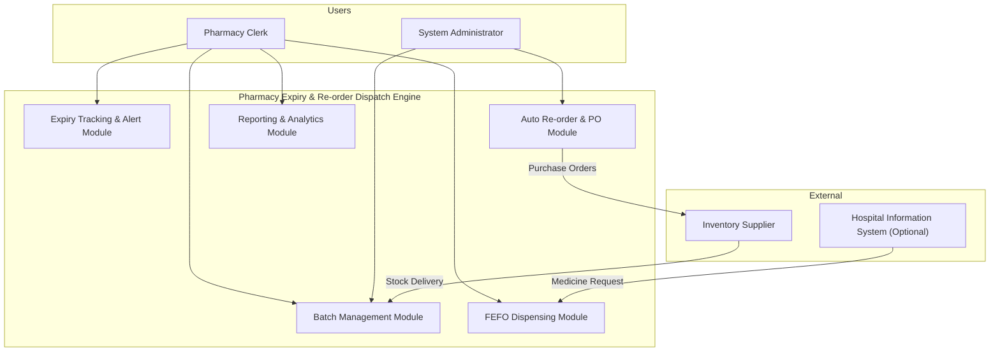
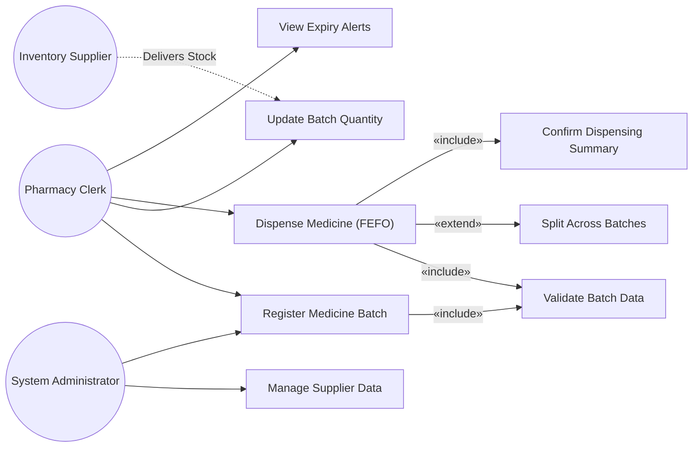
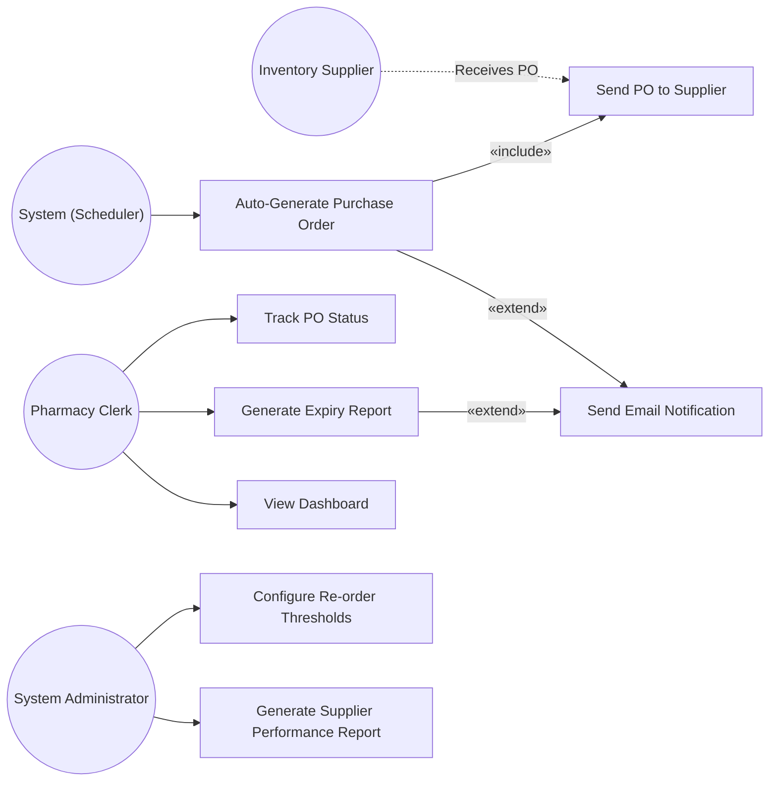

# Software Requirements Specification (SRS)

## Pharmacy Expiry & Re-order Dispatch Engine

---

| Field              | Detail                                                  |
|--------------------|---------------------------------------------------------|
| **Document Title** | Software Requirements Specification                     |
| **Project**        | Pharmacy Expiry & Re-order Dispatch Engine               |
| **Problem Statement** | #15 — Healthcare & Telemedicine Domain               |
| **University**     | PES University — Dept. of Computer Science & Engineering |
| **Course**         | Software Engineering Lab (UE22CS352A)                   |
| **Authors**        | Devraj M (devrajm2005)                                  |
| **Version**        | 1.0                                                     |
| **Date**           | November 2026                                           |
| **Status**         | Submitted                                               |

---

## Revision History

| Version | Date            | Author              | Description               |
|---------|-----------------|----------------------|---------------------------|
| 1.0     | November 2026   | Devraj M (devrajm2005) | Initial SRS release     |

---

## Table of Contents

1. [Introduction](#1-introduction)
2. [Overall Description](#2-overall-description)
3. [External Interface Requirements](#3-external-interface-requirements)
4. [System Features (Detailed Functional Requirements)](#4-system-features-detailed-functional-requirements)
5. [Non-Functional Requirements (Detailed)](#5-non-functional-requirements-detailed)
6. [Quality Attributes & Acceptance Tests](#6-quality-attributes--acceptance-tests)
7. [System Models and Diagrams](#7-system-models-and-diagrams)
8. [Requirements Traceability Matrix (RTM)](#8-requirements-traceability-matrix-rtm)
9. [Use-Case Flow Specification — FEFO Dispensing](#9-use-case-flow-specification--fefo-dispensing)

---

## 1. Introduction

### 1.1 Purpose

This Software Requirements Specification (SRS) document provides a complete and detailed description of the functional and non-functional requirements for the **Pharmacy Expiry & Re-order Dispatch Engine**. The system is designed to automate stock management within hospital pharmacies by tracking medicine batch expiry dates, generating First-Expired-First-Out (FEFO) dispensing lists, and triggering automated purchase orders when stock levels drop below defined safety thresholds. This document serves as a binding agreement between the development team and all stakeholders, and acts as a reference for design, implementation, testing, and validation phases throughout the software development life cycle.

### 1.2 Scope

The Pharmacy Expiry & Re-order Dispatch Engine is a web-based application targeted at hospital pharmacy environments. The system encompasses the following capabilities:

- **Medicine Batch Management** — Registration, tracking, and lifecycle management of medicine batches including quantity, manufacturing date, expiry date, supplier details, and batch identifiers.
- **FEFO Dispensing** — Automated enforcement of First-Expired-First-Out picking order during sales checkout to minimize wastage due to expiry.
- **Expiry Tracking & Alerting** — Continuous monitoring of batch expiry dates with configurable multi-tier alert notifications (e.g., 90-day, 60-day, 30-day warnings) to pharmacy staff.
- **Automated Re-order & Purchase Order Dispatch** — Rule-based automatic generation and dispatch of purchase order requests to registered suppliers when item stock levels dip below configurable safety thresholds.
- **Reporting & Analytics** — Dashboard and downloadable reports covering expiry trends, stock turnover, wastage metrics, and supplier performance.

The system does **not** cover patient medical record management, prescription validation by physicians, or billing/insurance claim processing.

### 1.3 Intended Audience

| Audience                  | Usage                                                                 |
|---------------------------|-----------------------------------------------------------------------|
| Development Team          | Use as the primary reference for system design and implementation     |
| QA / Testing Team         | Derive test plans, test cases, and acceptance criteria                |
| Project Manager           | Track requirement coverage and project scope                         |
| Pharmacy Clerks (End Users) | Validate that the described features meet operational needs         |
| Inventory Suppliers       | Understand the purchase-order interface and integration points       |
| University Evaluators     | Assess completeness and quality of the SE deliverable                |

### 1.4 Definitions, Acronyms, and Abbreviations

| Term / Acronym | Definition                                                                 |
|----------------|---------------------------------------------------------------------------|
| FEFO           | First-Expired-First-Out — dispensing policy prioritizing nearest expiry    |
| PO             | Purchase Order — formal document sent to a supplier to request stock      |
| SKU            | Stock Keeping Unit — unique identifier for each distinct medicine product |
| Batch ID       | Unique identifier assigned to a specific manufacturing lot of a medicine  |
| Safety Threshold | Minimum stock quantity below which an automatic re-order is triggered   |
| Lead Time      | Time between placing a purchase order and receiving the stock             |
| SRS            | Software Requirements Specification                                      |
| FR             | Functional Requirement                                                    |
| NFR            | Non-Functional Requirement                                                |
| RTM            | Requirements Traceability Matrix                                          |
| RBAC           | Role-Based Access Control                                                 |
| GUI            | Graphical User Interface                                                  |
| API            | Application Programming Interface                                        |
| HTTPS          | Hypertext Transfer Protocol Secure                                       |
| CDSCO          | Central Drugs Standard Control Organisation (India)                       |

### 1.5 References

1. IEEE Std 830-1998 — IEEE Recommended Practice for Software Requirements Specifications.
2. Drugs and Cosmetics Act, 1940 (India) — regulatory framework for pharmaceutical inventory tracking.
3. WHO Guidelines on Good Storage Practices for Pharmaceuticals, Technical Report Series No. 908.
4. PES University — Software Engineering Lab Course Manual, 2026.

---

## 2. Overall Description

### 2.1 Product Perspective

The Pharmacy Expiry & Re-order Dispatch Engine is a self-contained, web-based application designed to operate within the pharmacy department of a hospital. It may optionally integrate with an existing Hospital Information System (HIS) or Enterprise Resource Planning (ERP) system through well-defined REST APIs but is fully functional as a standalone solution. The system replaces manual, spreadsheet-based inventory tracking and order management with an automated, rule-driven engine.

### 2.2 Major Product Functions

| # | Function                          | Description                                                                                       |
|---|-----------------------------------|---------------------------------------------------------------------------------------------------|
| 1 | Medicine Batch Registration       | Add new medicine batches with details including name, SKU, batch ID, quantity, MFG date, expiry date, and supplier. |
| 2 | Batch Lifecycle Management        | Update quantities on receipt/dispatch; mark batches as expired, recalled, or depleted.            |
| 3 | FEFO Dispensing Engine            | Automatically select the batch with the nearest valid expiry date during checkout.                |
| 4 | Multi-tier Expiry Alerts          | Generate configurable alerts at 90, 60, and 30 days before batch expiry and flag expired stock.   |
| 5 | Expired Stock Quarantine          | Automatically quarantine expired batches to prevent dispensing.                                   |
| 6 | Automated Re-order Trigger        | Monitor stock levels and generate purchase orders when quantities fall below safety thresholds.   |
| 7 | Purchase Order Dispatch           | Send PO requests to registered suppliers via email or API integration.                            |
| 8 | Dashboard & Reports               | Provide real-time dashboards and downloadable CSV/PDF reports on inventory health.                |
| 9 | Audit Trail                       | Log all inventory transactions with timestamps and user identifiers for regulatory compliance.    |
| 10| Role-Based Access Control         | Restrict system actions based on user roles (Clerk, Administrator).                              |

### 2.3 User Roles and Characteristics

| Role               | Description                                                                                                        | Technical Proficiency |
|--------------------|--------------------------------------------------------------------------------------------------------------------|-----------------------|
| **Pharmacy Clerk** | Primary day-to-day user. Registers incoming stock, processes dispensing transactions, reviews expiry alerts, and generates operational reports. | Low to Moderate       |
| **Inventory Supplier** | External actor who receives purchase order requests dispatched by the system and delivers stock to the pharmacy. Interacts via email/portal. | Low                   |
| **System Administrator** | Configures system parameters (alert thresholds, re-order rules, supplier contacts), manages user accounts, and oversees audit logs. | High                  |

### 2.4 Operating Environment

| Component          | Specification                                                       |
|--------------------|---------------------------------------------------------------------|
| **Client**         | Modern web browser (Chrome 100+, Firefox 100+, Edge 100+)          |
| **Server OS**      | Ubuntu 22.04 LTS / Windows Server 2022                             |
| **Runtime**        | Node.js 18 LTS or Python 3.10+                                     |
| **Database**       | PostgreSQL 15+ (relational, ACID-compliant)                        |
| **Web Server**     | Nginx / Apache as reverse proxy                                    |
| **Network**        | Hospital LAN with HTTPS (TLS 1.2+); optional VPN for supplier portal |
| **Mail Server**    | SMTP-compatible mail service for PO dispatch and alert emails       |

### 2.5 Design and Implementation Constraints

| # | Constraint                                                                                                      |
|---|-----------------------------------------------------------------------------------------------------------------|
| 1 | The system must comply with India's Drugs and Cosmetics Act, 1940 regarding pharmaceutical record-keeping.      |
| 2 | All data at rest and in transit must be encrypted (AES-256 / TLS 1.2+).                                         |
| 3 | The system must support a minimum audit-log retention period of 5 years as per CDSCO guidelines.                |
| 4 | The application must be deployable on standard hospital-grade hardware without requiring GPU acceleration.       |
| 5 | The project shall be developed using open-source frameworks and tools with no proprietary license dependencies.  |
| 6 | The user interface must be accessible (WCAG 2.1 Level AA) to support users with visual impairments.             |

### 2.6 Assumptions and Dependencies

| # | Assumption / Dependency                                                                                         |
|---|-----------------------------------------------------------------------------------------------------------------|
| 1 | Pharmacy staff will be trained on system usage before go-live.                                                   |
| 2 | Each medicine batch has a unique Batch ID assigned by the manufacturer.                                          |
| 3 | Supplier email addresses or API endpoints are pre-configured by the administrator.                               |
| 4 | The hospital network provides reliable internet connectivity for supplier PO dispatch.                           |
| 5 | Expiry dates printed on medicine packaging are accurate and entered correctly during batch registration.         |
| 6 | The PostgreSQL database server is provisioned and maintained by the hospital IT team.                            |

---

## 3. External Interface Requirements

### 3.1 User Interfaces

The system shall provide a responsive web-based GUI accessible via standard web browsers. The interface shall include:

| UI Screen                     | Description                                                                                         |
|-------------------------------|-----------------------------------------------------------------------------------------------------|
| **Login Screen**              | Secure authentication form with username, password, and optional MFA token field.                  |
| **Dashboard**                 | Summary view showing total SKUs, batches nearing expiry, low-stock items, and recent PO statuses.  |
| **Batch Registration Form**   | Form to enter medicine name, SKU, batch ID, quantity, MFG date, expiry date, and supplier.         |
| **Dispensing Checkout Screen**| Medicine search with auto-suggested FEFO batch; quantity input and confirmation.                   |
| **Expiry Alert Panel**        | Sortable/filterable list of batches approaching expiry, color-coded by urgency (red/amber/yellow). |
| **Purchase Order Manager**    | List of auto-generated and manual POs with statuses (Draft, Sent, Acknowledged, Fulfilled).        |
| **Reports Screen**            | Date-range selectors, chart widgets, and export buttons (CSV, PDF) for inventory analytics.        |
| **Admin Settings**            | Configuration panels for alert thresholds, re-order rules, supplier management, and user roles.    |

### 3.2 Hardware Interfaces

The system does not require specialized hardware. It shall operate on standard server hardware and be accessed from any device with a modern web browser. Optional hardware integration includes:

| Hardware            | Interface                                                         |
|---------------------|-------------------------------------------------------------------|
| Barcode Scanner     | USB HID-compliant; scanned Batch IDs populate input fields automatically. |
| Receipt Printer     | Standard thermal printer via browser print dialog for dispensing receipts. |

### 3.3 Software Interfaces

| External System          | Interface Type | Description                                                             |
|--------------------------|----------------|-------------------------------------------------------------------------|
| PostgreSQL Database      | JDBC / ORM     | Persistent storage for all inventory, transaction, and audit data.      |
| SMTP Mail Server         | SMTP (TLS)     | Sends purchase order emails and alert notifications to stakeholders.    |
| Hospital Information System (HIS) | REST API (JSON) | Optional — receives medicine dispensing requests and returns confirmation. |
| Supplier Portal          | REST API / Email | Dispatches purchase orders; receives order acknowledgements.          |

### 3.4 Communications Interfaces

| Protocol   | Usage                                                                |
|------------|----------------------------------------------------------------------|
| HTTPS      | All client-server communication encrypted via TLS 1.2+.             |
| SMTP/TLS   | Outbound email for PO dispatch and alert notifications.             |
| REST/JSON  | API communication with HIS and supplier systems.                    |
| WebSocket  | Real-time push notifications for critical expiry alerts on dashboard.|

---

## 4. System Features (Detailed Functional Requirements)

### 4.1 Medicine Batch Management

#### FR-001 — Register New Medicine Batch

| Field                  | Detail                                                                                                   |
|------------------------|----------------------------------------------------------------------------------------------------------|
| **Req ID**             | FR-001                                                                                                   |
| **Requirement**        | The system shall allow a Pharmacy Clerk to register a new medicine batch by entering medicine name, SKU, batch ID, quantity received, manufacturing date, expiry date, and supplier name. |
| **Type**               | Functional                                                                                               |
| **Priority**           | High                                                                                                     |
| **Source / Stakeholder**| Pharmacy Clerk                                                                                          |
| **Acceptance Criteria / Test Case Ref** | **Pass:** Batch is persisted in the database with all mandatory fields populated and a unique Batch ID; confirmation message displayed. **Fail:** System rejects submission if any mandatory field is blank or expiry date is earlier than manufacturing date. **TC Ref:** TC-001 |
| **Comments / Dependencies** | Depends on supplier master data being pre-configured (FR-003). Batch ID uniqueness enforced at DB level. |

#### FR-002 — Update Batch Quantity on Stock Receipt

| Field                  | Detail                                                                                                   |
|------------------------|----------------------------------------------------------------------------------------------------------|
| **Req ID**             | FR-002                                                                                                   |
| **Requirement**        | The system shall allow a Pharmacy Clerk to update the on-hand quantity of an existing batch upon receiving additional stock from a supplier against an open purchase order. |
| **Type**               | Functional                                                                                               |
| **Priority**           | High                                                                                                     |
| **Source / Stakeholder**| Pharmacy Clerk                                                                                          |
| **Acceptance Criteria / Test Case Ref** | **Pass:** Quantity is incremented correctly; PO status updated to "Fulfilled" if fully received. **Fail:** System rejects negative or zero quantity inputs. **TC Ref:** TC-002 |
| **Comments / Dependencies** | Linked to PO records (FR-011). Audit log entry created (NFR-004).                                   |

#### FR-003 — Manage Supplier Master Data

| Field                  | Detail                                                                                                   |
|------------------------|----------------------------------------------------------------------------------------------------------|
| **Req ID**             | FR-003                                                                                                   |
| **Requirement**        | The system shall allow a System Administrator to add, edit, and deactivate supplier records including supplier name, contact email, phone number, API endpoint (if applicable), and lead time in days. |
| **Type**               | Functional                                                                                               |
| **Priority**           | Medium                                                                                                   |
| **Source / Stakeholder**| System Administrator, Inventory Supplier                                                                |
| **Acceptance Criteria / Test Case Ref** | **Pass:** Supplier record created/updated successfully; deactivated suppliers excluded from PO dispatch. **Fail:** Duplicate supplier name rejected; invalid email format rejected. **TC Ref:** TC-003 |
| **Comments / Dependencies** | Supplier data referenced by FR-001 (batch registration) and FR-011 (PO generation).                 |

---

### 4.2 FEFO Dispensing

#### FR-004 — Enforce FEFO Picking Order

| Field                  | Detail                                                                                                   |
|------------------------|----------------------------------------------------------------------------------------------------------|
| **Req ID**             | FR-004                                                                                                   |
| **Requirement**        | The system shall enforce FEFO picking order by prioritizing medicine batches with the nearest expiry date during sales checkout. |
| **Type**               | Functional                                                                                               |
| **Priority**           | High                                                                                                     |
| **Source / Stakeholder**| Pharmacy Clerk                                                                                          |
| **Acceptance Criteria / Test Case Ref** | **Pass:** Oldest valid (unexpired) batch is selected first for dispensing. **Fail:** Newer batch is assigned while an older unexpired batch with sufficient quantity still exists. **TC Ref:** TC-004 |
| **Comments / Dependencies** | Expired and quarantined batches (FR-008) must be excluded from FEFO selection.                       |

#### FR-005 — Split Dispensing Across Batches

| Field                  | Detail                                                                                                   |
|------------------------|----------------------------------------------------------------------------------------------------------|
| **Req ID**             | FR-005                                                                                                   |
| **Requirement**        | The system shall automatically split a dispensing request across multiple batches in FEFO order when the nearest-expiry batch has insufficient quantity to fulfill the full request. |
| **Type**               | Functional                                                                                               |
| **Priority**           | High                                                                                                     |
| **Source / Stakeholder**| Pharmacy Clerk                                                                                          |
| **Acceptance Criteria / Test Case Ref** | **Pass:** Dispensing pulls maximum available from the nearest-expiry batch, then continues to the next nearest-expiry batch until the requested quantity is fulfilled. **Fail:** System rejects the transaction instead of splitting, or skips a valid batch. **TC Ref:** TC-005 |
| **Comments / Dependencies** | Depends on FR-004 (FEFO logic). Each batch quantity deducted individually; audit entries per batch.  |

#### FR-006 — Dispensing Transaction Confirmation

| Field                  | Detail                                                                                                   |
|------------------------|----------------------------------------------------------------------------------------------------------|
| **Req ID**             | FR-006                                                                                                   |
| **Requirement**        | The system shall display a dispensing summary (medicine name, batch IDs used, quantities per batch, and total dispensed) for Pharmacy Clerk confirmation before committing the transaction. |
| **Type**               | Functional                                                                                               |
| **Priority**           | Medium                                                                                                   |
| **Source / Stakeholder**| Pharmacy Clerk                                                                                          |
| **Acceptance Criteria / Test Case Ref** | **Pass:** Summary screen shows correct FEFO-ordered batch breakdown; clerk confirms and stock is deducted. **Fail:** Transaction committed without clerk confirmation. **TC Ref:** TC-006 |
| **Comments / Dependencies** | Depends on FR-004, FR-005. Confirmation step prevents accidental dispensing errors.                  |

---

### 4.3 Expiry Tracking & Alerts

#### FR-007 — Multi-tier Expiry Alert Generation

| Field                  | Detail                                                                                                   |
|------------------------|----------------------------------------------------------------------------------------------------------|
| **Req ID**             | FR-007                                                                                                   |
| **Requirement**        | The system shall automatically generate expiry warning alerts at configurable intervals (default: 90, 60, and 30 days before expiry) for all active medicine batches and display them on the Expiry Alert Panel. |
| **Type**               | Functional                                                                                               |
| **Priority**           | High                                                                                                     |
| **Source / Stakeholder**| Pharmacy Clerk, System Administrator                                                                    |
| **Acceptance Criteria / Test Case Ref** | **Pass:** Alerts generated at each threshold and shown color-coded (yellow ≥ 60 days, amber 30–59 days, red < 30 days). **Fail:** Batches within threshold window not flagged, or alert generated for already-expired stock only. **TC Ref:** TC-007 |
| **Comments / Dependencies** | Alert thresholds configurable by Admin. Depends on batch expiry dates in FR-001.                     |

#### FR-008 — Automatic Quarantine of Expired Batches

| Field                  | Detail                                                                                                   |
|------------------------|----------------------------------------------------------------------------------------------------------|
| **Req ID**             | FR-008                                                                                                   |
| **Requirement**        | The system shall automatically change the status of a medicine batch to "Quarantined" on the day its expiry date is reached, preventing it from being included in FEFO dispensing or any stock-out transaction. |
| **Type**               | Functional                                                                                               |
| **Priority**           | High                                                                                                     |
| **Source / Stakeholder**| Pharmacy Clerk                                                                                          |
| **Acceptance Criteria / Test Case Ref** | **Pass:** Batch status set to "Quarantined" at midnight on expiry date; batch excluded from all dispensing queries. **Fail:** Expired batch remains available for dispensing. **TC Ref:** TC-008 |
| **Comments / Dependencies** | Runs as a daily scheduled job (cron). Quarantined batches visible in expiry report (FR-013).          |

#### FR-009 — Email Notification for Critical Expiry Alerts

| Field                  | Detail                                                                                                   |
|------------------------|----------------------------------------------------------------------------------------------------------|
| **Req ID**             | FR-009                                                                                                   |
| **Requirement**        | The system shall send an email notification to configured Pharmacy Clerk email addresses when any batch enters the red-tier alert zone (< 30 days to expiry) and when a batch is quarantined. |
| **Type**               | Functional                                                                                               |
| **Priority**           | Medium                                                                                                   |
| **Source / Stakeholder**| Pharmacy Clerk                                                                                          |
| **Acceptance Criteria / Test Case Ref** | **Pass:** Email received within 15 minutes of alert trigger with batch details (medicine name, batch ID, expiry date, quantity remaining). **Fail:** No email sent, or email missing critical batch information. **TC Ref:** TC-009 |
| **Comments / Dependencies** | Depends on SMTP configuration (Section 3.3). Email template managed by Admin.                        |

---

### 4.4 Auto Re-order & Purchase Orders

#### FR-010 — Configure Re-order Safety Thresholds

| Field                  | Detail                                                                                                   |
|------------------------|----------------------------------------------------------------------------------------------------------|
| **Req ID**             | FR-010                                                                                                   |
| **Requirement**        | The system shall allow a System Administrator to configure per-SKU safety stock thresholds (minimum quantity) and re-order quantities that trigger automatic purchase order generation. |
| **Type**               | Functional                                                                                               |
| **Priority**           | High                                                                                                     |
| **Source / Stakeholder**| System Administrator                                                                                    |
| **Acceptance Criteria / Test Case Ref** | **Pass:** Threshold and re-order quantity saved per SKU; values reflected in re-order engine calculations. **Fail:** Non-numeric or negative values accepted; threshold not applied during stock checks. **TC Ref:** TC-010 |
| **Comments / Dependencies** | Default threshold = 50 units if not configured. Referenced by FR-011.                                |

#### FR-011 — Automatic Purchase Order Generation

| Field                  | Detail                                                                                                   |
|------------------------|----------------------------------------------------------------------------------------------------------|
| **Req ID**             | FR-011                                                                                                   |
| **Requirement**        | The system shall automatically generate and dispatch supplier purchase order requests when item stock dips below the configured safety threshold for that SKU. |
| **Type**               | Functional                                                                                               |
| **Priority**           | High                                                                                                     |
| **Source / Stakeholder**| System Administrator, Inventory Supplier                                                                |
| **Acceptance Criteria / Test Case Ref** | **Pass:** PO auto-generated with correct SKU, re-order quantity, and assigned supplier within 5 minutes of threshold breach; PO status set to "Sent." **Fail:** No PO generated when stock is below threshold, or PO sent to wrong supplier. **TC Ref:** TC-011 |
| **Comments / Dependencies** | Depends on FR-010 (thresholds) and FR-003 (supplier data). Duplicate PO prevention: no new PO if an open PO for the same SKU exists. |

#### FR-012 — Purchase Order Status Tracking

| Field                  | Detail                                                                                                   |
|------------------------|----------------------------------------------------------------------------------------------------------|
| **Req ID**             | FR-012                                                                                                   |
| **Requirement**        | The system shall allow the Pharmacy Clerk to view and update the status of purchase orders through the lifecycle: Draft → Sent → Acknowledged → Fulfilled → Closed. |
| **Type**               | Functional                                                                                               |
| **Priority**           | Medium                                                                                                   |
| **Source / Stakeholder**| Pharmacy Clerk, Inventory Supplier                                                                      |
| **Acceptance Criteria / Test Case Ref** | **Pass:** PO statuses update correctly; "Fulfilled" status set automatically upon full stock receipt (FR-002). **Fail:** Status transitions allow invalid sequences (e.g., Draft → Closed). **TC Ref:** TC-012 |
| **Comments / Dependencies** | Supplier may acknowledge via email reply or portal. Links to FR-002 for receipt.                     |

---

### 4.5 Reporting & Analytics

#### FR-013 — Expiry Wastage Report

| Field                  | Detail                                                                                                   |
|------------------------|----------------------------------------------------------------------------------------------------------|
| **Req ID**             | FR-013                                                                                                   |
| **Requirement**        | The system shall generate a report listing all quarantined/expired batches within a user-specified date range, including medicine name, batch ID, quantity wasted, and monetary value of wastage. |
| **Type**               | Functional                                                                                               |
| **Priority**           | Medium                                                                                                   |
| **Source / Stakeholder**| Pharmacy Clerk, System Administrator                                                                    |
| **Acceptance Criteria / Test Case Ref** | **Pass:** Report displays accurate data matching quarantined records; exportable as CSV and PDF. **Fail:** Report omits quarantined batches or shows incorrect wastage value. **TC Ref:** TC-013 |
| **Comments / Dependencies** | Depends on FR-008 (quarantine data). Monetary value derived from batch unit cost × wasted quantity.  |

#### FR-014 — Stock Turnover & Inventory Health Dashboard

| Field                  | Detail                                                                                                   |
|------------------------|----------------------------------------------------------------------------------------------------------|
| **Req ID**             | FR-014                                                                                                   |
| **Requirement**        | The system shall provide a real-time dashboard displaying total active SKUs, batches nearing expiry (by tier), current low-stock items, open purchase orders, and a stock turnover ratio chart for the past 12 months. |
| **Type**               | Functional                                                                                               |
| **Priority**           | Medium                                                                                                   |
| **Source / Stakeholder**| Pharmacy Clerk, System Administrator                                                                    |
| **Acceptance Criteria / Test Case Ref** | **Pass:** Dashboard loads within 3 seconds; all widgets reflect current database state; charts render correctly. **Fail:** Stale data displayed (> 5 minutes old) or chart rendering errors. **TC Ref:** TC-014 |
| **Comments / Dependencies** | Uses aggregated data from all modules. Refresh interval configurable (default: 60 seconds).          |

#### FR-015 — Supplier Performance Report

| Field                  | Detail                                                                                                   |
|------------------------|----------------------------------------------------------------------------------------------------------|
| **Req ID**             | FR-015                                                                                                   |
| **Requirement**        | The system shall generate a supplier performance report showing average lead time, order fulfillment rate, and number of rejected/short-shipped batches per supplier over a user-specified period. |
| **Type**               | Functional                                                                                               |
| **Priority**           | Low                                                                                                      |
| **Source / Stakeholder**| System Administrator                                                                                    |
| **Acceptance Criteria / Test Case Ref** | **Pass:** Report accurately calculates metrics from PO and stock receipt records; exportable as CSV/PDF. **Fail:** Metrics include cancelled POs in fulfillment rate or show incorrect lead times. **TC Ref:** TC-015 |
| **Comments / Dependencies** | Depends on FR-011 (PO data) and FR-002 (receipt data). Useful for supplier evaluation and negotiation.|

---

## 5. Non-Functional Requirements (Detailed)

### NFR-001 — Performance

| Field                  | Detail                                                                                                   |
|------------------------|----------------------------------------------------------------------------------------------------------|
| **Req ID**             | NFR-001                                                                                                  |
| **Requirement**        | The system shall respond to all user-initiated queries (batch lookup, dispensing search, report generation) within 3 seconds under normal load (up to 50 concurrent users) and within 5 seconds under peak load (up to 100 concurrent users). |
| **Type**               | Non-Functional — Performance                                                                             |
| **Priority**           | High                                                                                                     |
| **Source / Stakeholder**| Pharmacy Clerk, System Administrator                                                                    |
| **Acceptance Criteria / Test Case Ref** | **Pass:** 95th percentile response time ≤ 3 s at 50 users; ≤ 5 s at 100 users measured via load test. **Fail:** Response time exceeds thresholds. **TC Ref:** TC-NFR-001 |
| **Comments / Dependencies** | Database indexing on SKU, Batch ID, and expiry date columns is essential.                            |

### NFR-002 — Reliability & Availability

| Field                  | Detail                                                                                                   |
|------------------------|----------------------------------------------------------------------------------------------------------|
| **Req ID**             | NFR-002                                                                                                  |
| **Requirement**        | The system shall maintain 99.5% uptime availability (measured monthly), with automated daily database backups and point-in-time recovery capability for the preceding 30 days. |
| **Type**               | Non-Functional — Reliability                                                                             |
| **Priority**           | High                                                                                                     |
| **Source / Stakeholder**| System Administrator                                                                                    |
| **Acceptance Criteria / Test Case Ref** | **Pass:** Monthly uptime ≥ 99.5%; backup recovery tested successfully within 1 hour RTO. **Fail:** Uptime below threshold or backup restoration fails. **TC Ref:** TC-NFR-002 |
| **Comments / Dependencies** | Requires scheduled PostgreSQL `pg_dump` and WAL archiving. UPS for server recommended.               |

### NFR-003 — Security & Regulatory Compliance

| Field                  | Detail                                                                                                   |
|------------------------|----------------------------------------------------------------------------------------------------------|
| **Req ID**             | NFR-003                                                                                                  |
| **Requirement**        | The system shall enforce role-based access control (RBAC), encrypt all data in transit (TLS 1.2+) and at rest (AES-256), and comply with the Drugs and Cosmetics Act, 1940 regarding pharmaceutical inventory record-keeping. |
| **Type**               | Non-Functional — Security / Compliance                                                                   |
| **Priority**           | High                                                                                                     |
| **Source / Stakeholder**| System Administrator, Regulatory Authority                                                              |
| **Acceptance Criteria / Test Case Ref** | **Pass:** Unauthorized role cannot access restricted endpoints (verified via penetration test); SSL Labs score ≥ A; encryption at rest verified. **Fail:** Privilege escalation possible or unencrypted data found. **TC Ref:** TC-NFR-003 |
| **Comments / Dependencies** | RBAC roles: Clerk (read + dispense), Admin (full access). Password policy: min 8 chars, complexity enforced. |

### NFR-004 — Audit & Data Retention

| Field                  | Detail                                                                                                   |
|------------------------|----------------------------------------------------------------------------------------------------------|
| **Req ID**             | NFR-004                                                                                                  |
| **Requirement**        | The system shall log all inventory transactions (batch registration, dispensing, quantity updates, PO actions) with user ID, timestamp, action type, and before/after values, retaining audit logs for a minimum of 5 years. |
| **Type**               | Non-Functional — Audit / Data Retention                                                                  |
| **Priority**           | High                                                                                                     |
| **Source / Stakeholder**| Regulatory Authority, System Administrator                                                              |
| **Acceptance Criteria / Test Case Ref** | **Pass:** Every transaction creates an immutable audit log entry; logs accessible for 5 years; no log deletion permitted by any user role. **Fail:** Transaction without corresponding audit entry, or logs deletable. **TC Ref:** TC-NFR-004 |
| **Comments / Dependencies** | Audit logs stored in separate database table/partition. Archival strategy required beyond 5 years.    |

### NFR-005 — Usability

| Field                  | Detail                                                                                                   |
|------------------------|----------------------------------------------------------------------------------------------------------|
| **Req ID**             | NFR-005                                                                                                  |
| **Requirement**        | The system shall be usable by a Pharmacy Clerk with no prior technical training beyond a 2-hour onboarding session. The interface shall conform to WCAG 2.1 Level AA accessibility standards. |
| **Type**               | Non-Functional — Usability                                                                               |
| **Priority**           | Medium                                                                                                   |
| **Source / Stakeholder**| Pharmacy Clerk                                                                                          |
| **Acceptance Criteria / Test Case Ref** | **Pass:** 90% of test users complete core tasks (register batch, dispense medicine, view alerts) within 5 minutes after onboarding; WCAG 2.1 AA audit passes. **Fail:** Task completion rate < 90% or critical accessibility violations found. **TC Ref:** TC-NFR-005 |
| **Comments / Dependencies** | UI design must include tooltips, contextual help, and consistent navigation patterns.                |

---

### 5.1 Security Requirements (Detailed)

#### 5.1.1 Security Objectives

| # | Security Objective                                                                                              |
|---|----------------------------------------------------------------------------------------------------------------|
| 1 | **Confidentiality** — Ensure that pharmaceutical inventory data, supplier contracts, and audit logs are accessible only to authorized personnel with appropriate role-based permissions. |
| 2 | **Integrity** — Guarantee that all inventory records, dispensing transactions, and purchase orders are tamper-proof and that any modification is tracked through immutable audit logs. |

#### 5.1.2 Security Requirements

| Req ID       | Requirement                                                                                                          | Priority | Test Case Ref |
|--------------|----------------------------------------------------------------------------------------------------------------------|----------|---------------|
| PRJ-SR-001   | The system shall enforce RBAC with at minimum two roles (Pharmacy Clerk, System Administrator), restricting access to configuration and audit functions to administrators only. | High     | TC-SR-001     |
| PRJ-SR-002   | The system shall enforce a password policy requiring minimum 8 characters, at least one uppercase letter, one digit, and one special character, with mandatory password rotation every 90 days. | High     | TC-SR-002     |
| PRJ-SR-003   | The system shall lock a user account after 5 consecutive failed login attempts and require administrator intervention or a time-based unlock (30 minutes) to restore access. | High     | TC-SR-003     |
| PRJ-SR-004   | The system shall encrypt all data in transit using TLS 1.2 or higher and encrypt sensitive data at rest (batch cost data, supplier contracts) using AES-256 encryption. | High     | TC-SR-004     |
| PRJ-SR-005   | The system shall implement session timeout after 15 minutes of inactivity, requiring re-authentication, and shall invalidate all active sessions upon password change. | Medium   | TC-SR-005     |

---

## 6. Quality Attributes & Acceptance Tests

| Quality Attribute  | Metric / Target                                                    | Acceptance Test Description                                                                                       | Test ID      |
|--------------------|--------------------------------------------------------------------|-------------------------------------------------------------------------------------------------------------------|--------------|
| **Performance**    | 95th percentile response ≤ 3 s @ 50 users                        | Execute JMeter load test with 50 virtual users performing batch lookup and dispensing operations for 10 minutes.   | AT-001       |
| **Reliability**    | 99.5% monthly uptime                                              | Monitor system over 30-day pilot; compute uptime from server health-check logs. Verify backup restore within 1 hr.| AT-002       |
| **Security**       | Zero critical/high vulnerabilities in OWASP Top-10 scan           | Run OWASP ZAP automated scan against all endpoints; verify no critical or high-severity findings.                 | AT-003       |
| **Usability**      | 90% task completion within 5 min post-training                    | Conduct usability test with 10 pharmacy clerks performing 5 core tasks after 2-hour training session.             | AT-004       |
| **Data Integrity** | Zero orphaned or duplicate audit log entries across 1000 transactions | Execute 1000 mixed transactions (register, dispense, PO); verify 1:1 correspondence with audit log entries.    | AT-005       |
| **FEFO Accuracy**  | 100% correct batch selection in FEFO dispensing                   | Run 200 dispensing operations across varying batch expiry dates; verify oldest unexpired batch always selected.    | AT-006       |
| **Scalability**    | System supports 10,000 active batches without degradation         | Load database with 10,000 batch records; execute standard queries and verify response within NFR-001 thresholds.  | AT-007       |
| **Recoverability** | RTO ≤ 1 hour, RPO ≤ 24 hours                                     | Simulate server failure; restore from latest backup; verify data loss within 24-hour window.                      | AT-008       |

---

## 7. System Models and Diagrams

### 7.1 Use-Case Diagram 1 — Inventory Management & Dispensing

> **Description:** This diagram models the core inventory and dispensing interactions. The Pharmacy Clerk registers batches and dispenses medicines. The `Validate Batch Data` use case is **included** in both registration and dispensing to ensure data integrity. The `Split Across Batches` use case **extends** dispensing — it is triggered only when the nearest-expiry batch has insufficient quantity. The `Confirm Dispensing Summary` use case is **included** in every dispensing transaction to require clerk confirmation.

### 7.2 Use-Case Diagram 2 — Re-order, Alerts & Reporting

> **Description:** This diagram models the automated re-order and reporting subsystem. The System Scheduler triggers `Auto-Generate Purchase Order` when stock falls below thresholds. This **includes** `Send PO to Supplier` as a mandatory step. The `Send Email Notification` **extends** both PO generation (to notify the clerk) and expiry report generation (when critical expiry items are found). The Pharmacy Clerk tracks PO statuses and generates reports; the Administrator configures thresholds and reviews supplier performance.

---

## 8. Requirements Traceability Matrix (RTM)

| Req ID      | Requirement Summary                          | Module                        | Design Ref   | Test Case ID | Test Type        | Status    |
|-------------|----------------------------------------------|-------------------------------|--------------|--------------|------------------|-----------|
| FR-001      | Register new medicine batch                  | Batch Management              | DM-001       | TC-001       | Functional       | Planned   |
| FR-002      | Update batch quantity on receipt              | Batch Management              | DM-002       | TC-002       | Functional       | Planned   |
| FR-003      | Manage supplier master data                  | Batch Management              | DM-003       | TC-003       | Functional       | Planned   |
| FR-004      | Enforce FEFO picking order                   | FEFO Dispensing               | DM-004       | TC-004       | Functional       | Planned   |
| FR-005      | Split dispensing across batches              | FEFO Dispensing               | DM-005       | TC-005       | Functional       | Planned   |
| FR-006      | Dispensing transaction confirmation          | FEFO Dispensing               | DM-006       | TC-006       | Functional       | Planned   |
| FR-007      | Multi-tier expiry alert generation           | Expiry Tracking               | DM-007       | TC-007       | Functional       | Planned   |
| FR-008      | Automatic quarantine of expired batches      | Expiry Tracking               | DM-008       | TC-008       | Functional       | Planned   |
| FR-009      | Email notification for critical alerts       | Expiry Tracking               | DM-009       | TC-009       | Functional       | Planned   |
| FR-010      | Configure re-order safety thresholds         | Auto Re-order                 | DM-010       | TC-010       | Functional       | Planned   |
| FR-011      | Automatic purchase order generation          | Auto Re-order                 | DM-011       | TC-011       | Functional       | Planned   |
| FR-012      | Purchase order status tracking               | Auto Re-order                 | DM-012       | TC-012       | Functional       | Planned   |
| FR-013      | Expiry wastage report                        | Reporting & Analytics         | DM-013       | TC-013       | Functional       | Planned   |
| FR-014      | Stock turnover & health dashboard            | Reporting & Analytics         | DM-014       | TC-014       | Functional       | Planned   |
| FR-015      | Supplier performance report                  | Reporting & Analytics         | DM-015       | TC-015       | Functional       | Planned   |
| NFR-001     | Response time ≤ 3 s @ 50 users               | All Modules                   | DM-PERF      | TC-NFR-001   | Performance      | Planned   |
| NFR-002     | 99.5% uptime, daily backups                  | Infrastructure                | DM-REL       | TC-NFR-002   | Reliability      | Planned   |
| NFR-003     | RBAC, encryption (TLS + AES-256)             | Security Module               | DM-SEC       | TC-NFR-003   | Security         | Planned   |
| NFR-004     | Immutable audit logs, 5-year retention       | Audit Module                  | DM-AUD       | TC-NFR-004   | Compliance       | Planned   |
| NFR-005     | Usability — 2-hr training, WCAG 2.1 AA      | UI/UX                         | DM-UX        | TC-NFR-005   | Usability        | Planned   |
| PRJ-SR-001  | RBAC enforcement (Clerk, Admin roles)        | Security Module               | DM-SEC       | TC-SR-001    | Security         | Planned   |
| PRJ-SR-002  | Password complexity & rotation policy        | Security Module               | DM-SEC       | TC-SR-002    | Security         | Planned   |
| PRJ-SR-003  | Account lockout after 5 failed attempts      | Security Module               | DM-SEC       | TC-SR-003    | Security         | Planned   |
| PRJ-SR-004  | TLS 1.2+ in transit, AES-256 at rest         | Security Module               | DM-SEC       | TC-SR-004    | Security         | Planned   |
| PRJ-SR-005  | Session timeout & invalidation on pwd change | Security Module               | DM-SEC       | TC-SR-005    | Security         | Planned   |

---

## 9. Use-Case Flow Specification — FEFO Dispensing

### Use Case: Dispense Medicine Using FEFO

| Field              | Detail                                                              |
|--------------------|---------------------------------------------------------------------|
| **Use Case ID**    | UC-003                                                              |
| **Use Case Name**  | Dispense Medicine (FEFO)                                            |
| **Primary Actor**  | Pharmacy Clerk                                                      |
| **Secondary Actors** | None                                                              |
| **Description**    | The Pharmacy Clerk processes a medicine dispensing request. The system automatically selects batches in FEFO order (nearest expiry first), deducts stock, and records the transaction. |
| **Trigger**        | Pharmacy Clerk initiates a dispensing transaction from the Dispensing Checkout Screen. |

#### Preconditions

1. The Pharmacy Clerk is authenticated and logged into the system with a valid session.
2. At least one active (non-expired, non-quarantined) batch of the requested medicine exists in inventory.
3. The requested medicine SKU is registered in the system.

#### Postconditions

1. The dispensed quantity has been deducted from the appropriate batch(es) in FEFO order.
2. An immutable audit log entry has been created for each batch quantity deduction.
3. If any batch quantity reaches zero, its status is updated to "Depleted."
4. If total SKU stock falls below the safety threshold, the auto re-order engine is triggered (FR-011).

#### Main Success Scenario

| Step | Actor           | Action                                                                                                         |
|------|-----------------|----------------------------------------------------------------------------------------------------------------|
| 1    | Pharmacy Clerk  | Navigates to the Dispensing Checkout Screen and enters or scans the medicine name/SKU.                        |
| 2    | System          | Searches active batches for the given SKU and retrieves all non-expired, non-quarantined batches sorted by expiry date (ascending — nearest expiry first). |
| 3    | System          | Validates that at least one valid batch exists. Displays the FEFO-recommended batch (nearest expiry) with batch ID, expiry date, and available quantity. |
| 4    | Pharmacy Clerk  | Enters the required dispensing quantity.                                                                       |
| 5    | System          | Checks if the nearest-expiry batch has sufficient quantity. If yes, allocates the full quantity from that batch.|
| 6    | System          | Displays the Dispensing Summary screen showing: medicine name, batch ID(s) used, quantity per batch, total quantity, and expiry date(s). |
| 7    | Pharmacy Clerk  | Reviews the summary and clicks "Confirm Dispensing."                                                          |
| 8    | System          | Deducts the dispensed quantity from the batch record(s) in the database.                                       |
| 9    | System          | Creates an audit log entry with: user ID, timestamp, action ("DISPENSE"), batch ID(s), quantities, before/after stock levels. |
| 10   | System          | Checks if the total SKU stock has fallen below the safety threshold. If yes, triggers the auto re-order engine (FR-011). |
| 11   | System          | Displays a "Dispensing Successful" confirmation message with a transaction reference number.                   |

#### Alternate Flow — AF1: Insufficient Quantity in Nearest-Expiry Batch (Split Dispensing)

| Step   | Actor  | Action                                                                                                                     |
|--------|--------|----------------------------------------------------------------------------------------------------------------------------|
| AF1-1  | System | At Step 5, the system detects that the nearest-expiry batch has fewer units than the requested quantity.                    |
| AF1-2  | System | Allocates all available units from the nearest-expiry batch and calculates the remaining quantity needed.                   |
| AF1-3  | System | Moves to the next batch in FEFO order and allocates from it. Repeats until the requested quantity is fully allocated or all batches are exhausted. |
| AF1-4  | System | If all batches are exhausted before fulfilling the full quantity, displays a warning: "Only {available} of {requested} units available. Proceed with partial dispensing?" |
| AF1-5  | Pharmacy Clerk | Accepts partial dispensing or cancels the transaction.                                                          |
| AF1-6  | System | If accepted, proceeds to Step 6 of the Main Success Scenario with multi-batch summary. If cancelled, no stock is deducted and the clerk is returned to Step 1. |

---

*End of Software Requirements Specification*

---

**Prepared by:** Devraj M (devrajm2005)
**Department of Computer Science & Engineering**
**PES University — November 2026**
